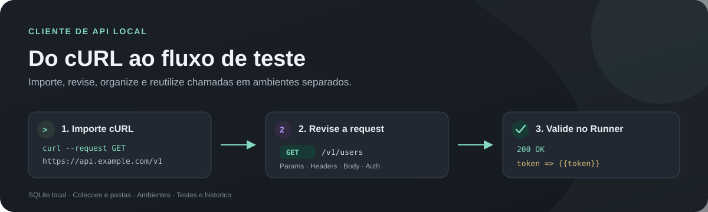
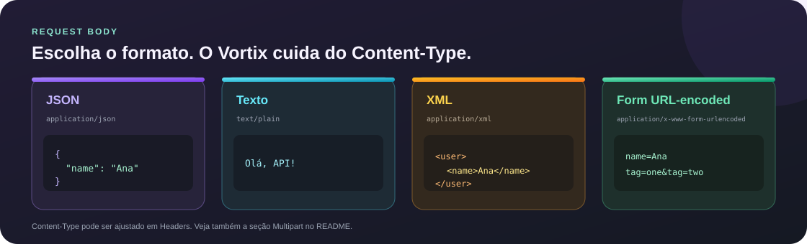
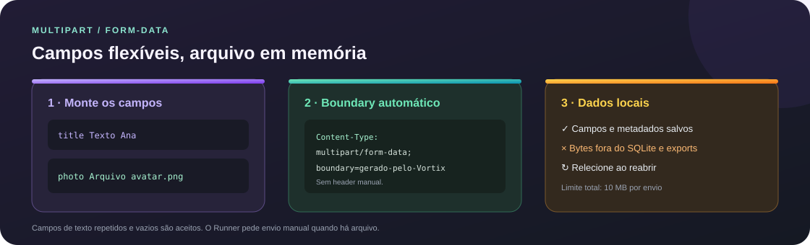
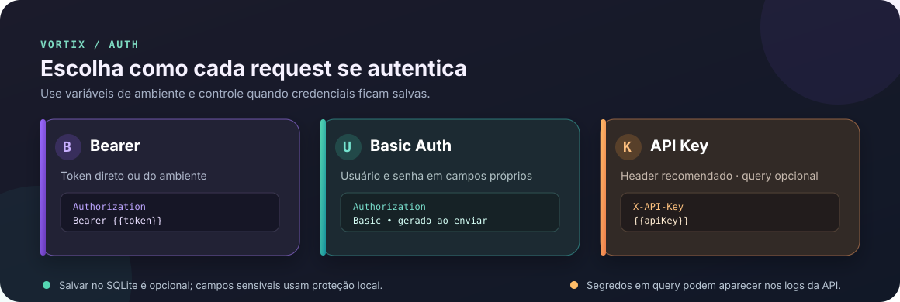
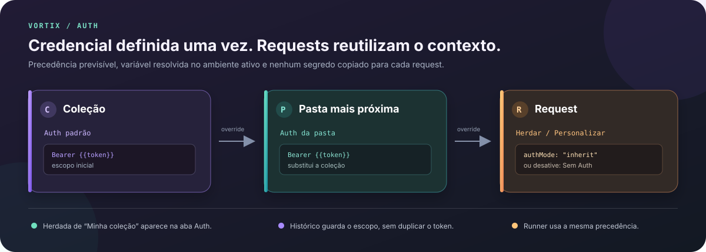
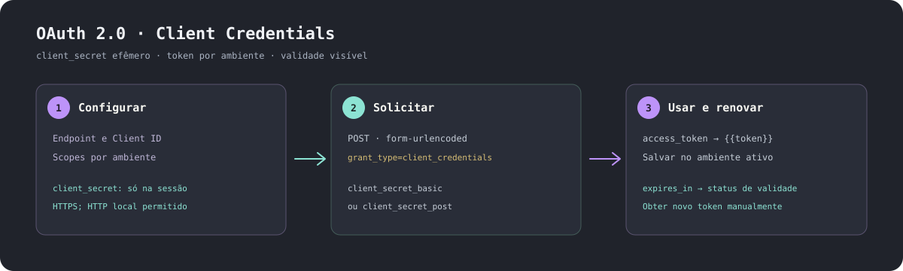
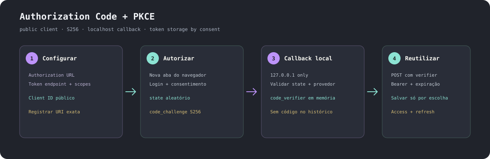
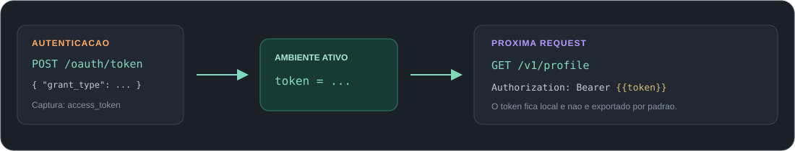

  

<h1 align="center">Vortix</h1>

Cliente HTTP agnóstico para criar, organizar, executar e repetir requisições de API.

ASP.NET Core 10 · SQLite local · IndexedDB no navegador

---

  

## Índice

- [Visão geral](#visão-geral)
- [Recursos](#recursos)
- [Requisitos](#requisitos)
- [Início rápido](#início-rápido)
- [Hospedagem pessoal no Render](#hospedagem-pessoal-no-render)
- [Primeiro fluxo](#primeiro-fluxo)
- [Busca rápida](#busca-rápida)
- [Autenticação](#autenticação)
  - [Auth herdada por coleção e pasta](#auth-herdada-por-coleção-e-pasta)
  - [OAuth 2.0 Client Credentials](#oauth-20-client-credentials)
  - [Authorization Code with PKCE](#authorization-code-with-pkce)
- [Modos de body](#modos-de-body)
- [Multipart form-data](#multipart-form-data)
- [GraphQL](#graphql)
  - [Schema, confirmação e autocomplete](#schema-confirmação-e-autocomplete)
- [Importar cURL](#importar-curl)
  - [Importar HTTPie](#importar-httpie)
- [Importar OpenAPI JSON](#importar-openapi-json)
- [Ambientes e variáveis](#ambientes-e-variáveis)
- [Scripts, testes e Runner](#scripts-testes-e-runner)
- [Importação e exportação](#importação-e-exportação)
- [Histórico de respostas](#histórico-de-respostas)
- [Persistência e backups](#persistência-e-backups)
- [Segurança](#segurança)
- [Configuração](#configuração)
- [Desenvolvimento e validação](#desenvolvimento-e-validação)
- [Estrutura do projeto](#estrutura-do-projeto)
- [Solução de problemas](#solução-de-problemas)
- [Plano de ação](ROADMAP.md)
- [Licenças das fontes](#licenças-das-fontes)

## Visão geral

Vortix é um cliente de APIs inspirado no fluxo de trabalho de ferramentas como Insomnia e Postman. O projeto é agnóstico: não inclui URL, rota, parâmetro, credencial ou regra de uma API específica.

A interface roda no navegador. Um servidor ASP.NET Core encaminha as requisições para a API escolhida, então o navegador não precisa acessar a API diretamente nem depender de CORS. No modo local, o workspace fica em SQLite no computador. No modo público, coleções, ambientes, requests, abas, configurações e histórico ficam no IndexedDB de cada perfil de navegador; o serviço não oferece contas nem sincroniza workspaces.

O modo público permite uso sem senha compartilhada. Cada navegador recebe uma sessão aleatória para isolar Cookie jars e fluxos OAuth temporários. O servidor não expõe o SQLite do workspace. O proxy limita chamadas e bloqueia destinos locais, privados e outros endereços não públicos.

## Recursos

- **Editor de requests:** GET, HEAD, POST, PUT, PATCH, DELETE e OPTIONS; URL base, rota, Params, Headers, body JSON/texto/XML/form URL-encoded/Multipart/GraphQL e Auth Bearer, Basic ou API Key.
- **Coleções:** coleções, pastas e subpastas para organizar requests.
- **Busca rápida:** encontre requests por texto ou filtre por método, status salvo e coleção/pasta usando `Ctrl+K`.
- **Ambientes:** variáveis próprias e Cookie jar isolado por ambiente, com substituição por templates como <code>{{baseUrl}}</code> e <code>{{token}}</code>.
- **Abas e histórico:** até 12 requests abertas; requests, status, duração e cabeçalhos filtrados ficam no SQLite local ou no IndexedDB do navegador. Bodies de resposta são opcionais e desativados por padrão.
- **Resposta:** visualização Pretty, Árvore ou Raw, cópia de cabeçalhos e body, busca, exemplos nomeados por request e simulação local sem chamar a API.
- **Captura de variáveis:** salve um campo JSON da resposta ou o texto completo no ambiente ativo.
- **OAuth 2.0:** Client Credentials e Authorization Code com PKCE S256; tokens salvos por ambiente com consentimento e proteção local.
- **Testes de resposta:** valide status HTTP, existência de campo JSON, igualdade ou presença de texto.
- **Runner:** execute requests de uma coleção ou pasta em sequência, com conjuntos de dados, intervalo, parada por falha e repetição das falhas.
- **Temas e fontes:** Dracula, Monokai, One Dark, Nord, Solarized Dark e GitHub Dark; Fira Code, JetBrains Mono, Cascadia Code, Cascadia Mono e IBM Plex Mono.
- **Editor JSON:** destaque de sintaxe e formatação com indentação de dois espaços.
- **Intercâmbio:** Vortix JSON, Insomnia v4, Postman Collection v2.1, cURL, HTTPie, OpenAPI 3 em JSON.
- **Backups:** exportação simples em JSON ou arquivo protegido por senha.

Requests novas começam vazias. A URL base e os demais valores vêm do ambiente e da configuração que você criar.

## Requisitos

- **.NET 10 SDK** para executar, compilar ou publicar o projeto.
- Navegador moderno com suporte a IndexedDB e Web Crypto.
- **Node.js 18 ou superior** para os testes de lógica JavaScript.
- **PowerShell e Python 3** para o teste integrado de proteção do SQLite.

A interface não exige npm nem framework JavaScript.

## Início rápido

### Windows

Na pasta do projeto, execute:

~~~powershell
.\VortixApiClient.cmd
~~~

O iniciador reutiliza uma instância Vortix que já responda no health check. Caso não exista, inicia o servidor e abre o navegador.

Os atalhos antigos Abrir-Testador-API.cmd, Abrir-Testador-API.ps1 e Validar-Testador.ps1 continuam disponíveis como wrappers de compatibilidade para os novos nomes Vortix.

### Outros sistemas ou execução manual

~~~sh
dotnet run --project ./VortixApiClient.csproj --no-launch-profile
~~~

Abra:

~~~text
http://127.0.0.1:51873/
~~~

Health check local:

~~~text
http://127.0.0.1:51873/health
~~~

O servidor usa a porta 51873 por padrão. Consulte [Configuração](#configuração) para alterá-la.

O endpoint <code>/health</code> preserva <code>app: ApiPublicacaoTester</code> para clientes antigos e informa <code>product: VortixApiClient</code> como identidade atual.

## Hospedagem pública no Render

O repositório inclui <code>Dockerfile</code> e <code>render.yaml</code> para criar um serviço web Render Free. O Vortix fica aberto para qualquer visitante, sem senha compartilhada. Cada perfil de navegador mantém workspace independente; o serviço encaminha as requests e não expõe dados de outros visitantes.

### Criar o serviço

1. Envie o repositório Vortix para o GitHub.
2. No Render, crie um **Blueprint** a partir do repositório e revise o serviço <code>vortix-api-client</code>. O Blueprint seleciona Docker e o plano Free.
3. Confirme <code>ApiStudio__PublicOrigin</code> com a origem HTTPS que você usará no navegador. O valor inicial do Blueprint é <code>https://apicliente.jeffymesquita.dev</code>.
4. O Render fornece <code>PORT</code> ao container. Não fixe uma porta diferente no painel. O serviço escuta em <code>0.0.0.0</code> somente no modo hospedado.
5. Aguarde o deploy e confira o health check <code>/health</code>.

O Blueprint já declara <code>apicliente.jeffymesquita.dev</code> como domínio personalizado. Se criar o serviço manualmente, adicione esse domínio nas configurações do Render. No provedor DNS do domínio, crie o CNAME para o destino exato exibido pelo Render. A configuração afeta apenas o host <code>apicliente</code>; mantenha os registros do domínio raiz e de e-mail. O Render configura e renova TLS para o domínio personalizado. Consulte [domínios personalizados do Render](https://render.com/docs/custom-domains) e [Blueprints](https://render.com/docs/blueprint-spec).

O modo Render também aceita a URL <code>onrender.com</code> que a plataforma fornece, mesmo antes do CNAME do domínio próprio resolver. A Redirect URI OAuth usa a origem aberta no navegador. Quando o DNS estiver configurado, o subdomínio próprio funcionará sem mudar a variável.

### Persistência e limites do plano Free

No modo público, o workspace fica diretamente no IndexedDB do navegador e continua lá quando Render reinicia. Os dados pertencem à origem e ao perfil de navegador; limpar dados do site, trocar de navegador ou usar outro dispositivo não transfere o workspace. Exporte um backup para migrá-lo. O IndexedDB não é criptografado automaticamente; use **Backup com senha** para criar um arquivo protegido.

O Render Free suspende serviços após 15 minutos sem tráfego, pode reiniciá-los e apaga arquivos locais ao dormir, reiniciar ou publicar uma nova versão. O primeiro acesso após suspensão pode levar cerca de um minuto. O plano Free não oferece disco persistente e a própria Render o recomenda para projetos de teste/hobby, não para aplicações de produção. Veja os [limites oficiais do plano Free](https://render.com/docs/free).

Qualquer pessoa poderá usar o proxy público. O limite por IP e o bloqueio de destinos privados reduzem abuso, mas não impedem consumo da cota gratuita por terceiros. Não use o plano Free como proxy crítico nem envie credenciais por HTTP sem TLS.

O SQLite temporário do serviço guarda apenas Cookie jars protegidos e isolados por uma sessão aleatória do navegador. Limpar os cookies do site pode iniciar um Cookie jar novo; reinício ou suspensão também pode apagar cookies e fluxos OAuth ainda abertos. Nenhum desses eventos apaga coleções ou histórico do IndexedDB.

O projeto e o container usam .NET 10 LTS. O suporte oficial vai até **14 de novembro de 2028**. Consulte a [política de suporte do .NET](https://learn.microsoft.com/en-us/dotnet/core/releases-and-support).

Como as requests são encaminhadas pelo servidor hospedado, ele só alcança endereços disponíveis a partir da rede do Render. <code>localhost</code>, <code>192.168.x.x</code> e outros endereços privados do computador não apontam para sua máquina e não serão acessíveis. Use o modo local para APIs da rede privada ou uma infraestrutura local/túnel separado.

Em hospedagem, o callback OAuth PKCE usa a origem pública configurada, não o callback loopback. Cadastre no provedor a URI exata mostrada pela aba **Auth** depois de publicar o domínio. Fluxos PKCE pendentes podem se perder quando o serviço gratuito suspende ou reinicia.

## Primeiro fluxo

1. Abra **Configurações → Ambientes** e crie um ambiente.
2. Adicione uma variável chamada <code>baseUrl</code>, por exemplo <code>https://api.example.com</code>.
3. Crie uma coleção e, se quiser, pastas para separar recursos ou cenários.
4. Crie uma request, escolha o método e informe a rota começando por <code>/</code>.
5. Preencha Params na aba **Params**. Os parâmetros são enviados na query string; nomes repetidos e valores vazios são aceitos.
6. Adicione cabeçalhos, autenticação e body nas respectivas abas.
7. Clique em **Enviar**. Depois, salve a request na coleção para reutilizá-la.

Exemplo:

| Campo | Valor |
|---|---|
| URL base | <code>{{baseUrl}}</code> |
| Rota | <code>/v1/users</code> |
| Params | <code>page=1</code> |
| Header | <code>Accept: application/json</code> |

Escolha **Body** para selecionar JSON, texto, XML ou form URL-encoded. O modo define o Content-Type padrão; um header Content-Type informado manualmente o sobrescreve.

## Busca rápida

Pressione `Ctrl+K` (ou `Cmd+K` no macOS) para abrir a busca global. Digite parte do nome, método, rota, coleção ou caminho da pasta; a busca ignora diferenças de acentuação. Use as setas para navegar e `Enter` para abrir a request em uma aba.

Os filtros podem ser combinados e também funcionam sem texto:

- **Método:** GET, HEAD, POST, PUT, PATCH, DELETE ou OPTIONS.
- **Status salvo:** status HTTP encontrado nos exemplos de resposta salvos nas coleções.
- **Coleção ou pasta:** limita a busca à coleção escolhida; uma pasta inclui também suas subpastas.

O status vem dos exemplos já salvos; a busca não envia requests nem altera o histórico. A lista mostra até 30 resultados por vez.

## Modos de body

O editor mantém o body como texto e oferece formatos prontos:

  

| Formato | Content-Type padrão |
|---|---|
| JSON | <code>application/json</code> |
| Texto | <code>text/plain</code> |
| XML | <code>application/xml</code> |
| Form URL-encoded | <code>application/x-www-form-urlencoded</code> |
| Multipart | <code>multipart/form-data</code> com boundary automático |

Exemplos:

~~~json
{"name":"Ana","active":true}
~~~

~~~text
Texto livre para uma API que não recebe JSON.
~~~

~~~xml
<request><name>Ana</name></request>
~~~

~~~text
name=Ana&tag=one&tag=two
~~~

O formato acompanha a request nas abas, histórico, coleções e Runner. Vortix JSON o preserva; Postman e Insomnia recebem o formato e Content-Type correspondentes.

O JSON mantém destaque, indentação e compactação. Para texto, XML e form URL-encoded, o editor mostra o conteúdo sem destaque JSON. O header Content-Type manual pode substituir o padrão. GET, HEAD e OPTIONS continuam sem body.

Multipart e GraphQL têm seções próprias abaixo. Veja o [plano de ação](ROADMAP.md).

## Multipart form-data

  

Adicione campos de texto e arquivos à mesma request. Nomes repetidos e valores vazios são aceitos. O Vortix cria o <code>Content-Type</code> e o boundary; remova qualquer <code>Content-Type</code> manual em **Headers**, pois ele é rejeitado para evitar um boundary inválido.

Exemplo do metadata que o workspace preserva:

~~~json
[
  { "name": "title", "type": "text", "value": "Ana" },
  { "name": "avatar", "type": "file", "fileName": "avatar.png", "contentType": "image/png" }
]
~~~

| Parte | O que fica salvo | Ao reabrir |
|---|---|---|
| Texto | Nome e valor; valores com nomes sensíveis são omitidos conforme as regras do workspace. | Disponível para edição e envio. |
| Arquivo | Nome do campo, nome do arquivo e tipo MIME. Os bytes não são gravados em SQLite, histórico, backup nem exportação. | Selecione o arquivo novamente. |

O limite total por envio é **10 MB**. O arquivo fica em memória durante a chamada e segue pelo proxy local. A request é preservada em JSON Vortix, Insomnia v4 e Postman Collection v2.1 com os metadados; nenhum formato de exportação inclui os bytes do arquivo.

O Runner executa campos de texto. Requests com arquivos precisam ser enviadas manualmente depois de selecionar os arquivos novamente.

## GraphQL

  

Edite a query, as variables JSON e o **Operation Name** em campos separados. O Vortix envia um POST com <code>Content-Type: application/json</code>:

~~~graphql
query GetUser($id: ID!) {
  user(id: $id) { id name }
}
~~~

~~~json
{
  "id": "{{userId}}"
}
~~~

O payload enviado é montado pelo Vortix:

~~~json
{
  "query": "query GetUser($id: ID!) { user(id: $id) { id name } }",
  "variables": { "id": "42" },
  "operationName": "GetUser"
}
~~~

Variables precisam ser um objeto JSON. Se o campo ficar vazio, a propriedade <code>variables</code> não é enviada. Templates de ambiente dentro dos valores são resolvidos no envio. Query, variables e operationName ficam salvos na request, histórico e abas; o Runner também os preserva. Requests com método diferente de POST são recusadas.

O intercâmbio Postman Collection v2.1 usa o body GraphQL. Insomnia v4 recebe o envelope JSON de query. Importação e exportação preservam query, variables e operationName. Veja as referências oficiais de [GraphQL no Postman](https://learning.postman.com/docs/use/send-requests/protocols/graphql/graphql-http) e [GraphQL no Insomnia](https://developer.konghq.com/insomnia/graphql/).

### Schema, confirmação e autocomplete

No body GraphQL, informe URL base, rota, Auth e Params da API; clique **Carregar schema**. O Vortix mostra a URL e pede confirmação antes de qualquer consulta, inclusive em localhost. Envia somente uma query de introspecção read-only por POST; query/variables que você esteja editando não são enviadas. O endpoint usa Auth e Cookie jar do ambiente ativo. HTTP remoto continua bloqueado sem autorização na request.

O schema fica somente em memória: não entra no histórico, coleções ou SQLite. Se a API aceitar introspecção, escolha um tipo no seletor para navegar seus campos. Digite o prefixo de um campo na query e use as setas/Enter para completar; clicar em um campo do browser também o insere na posição atual do cursor. Alterar endpoint, ambiente, Params, Headers ou Auth invalida o schema carregado; consulte novamente. APIs que desativam introspecção retornam erro sem expor o body da resposta no toast.

`GraphqlIntrospection.test.ps1` valida o proxy com um mock GraphQL em loopback. O teste confirma que o servidor envia somente a query fixa de introspecção, encaminha Auth e não adiciona a consulta ao histórico. Não usa endpoint externo.

A request continua agnóstica: informe o endpoint GraphQL da API que você estiver usando.

### Métodos e proteção de gravação

Todos os métodos suportados estão disponíveis no seletor. POST, PUT, PATCH e DELETE exigem digitar <code>TESTE</code>, marcar a confirmação e aceitar a confirmação final do navegador. No Runner, gravações também exigem a frase e confirmações correspondentes.

Essa proteção é uma confirmação manual. O Vortix não consegue determinar se os dados ou o ambiente de destino são descartáveis. GET, HEAD e OPTIONS não aceitam body.

## Autenticação

  

A aba **Auth** oferece três formas comuns de autenticar requests. Selecione o tipo, preencha os campos e reutilize variáveis do ambiente, como <code>{{token}}</code>, <code>{{usuario}}</code> ou <code>{{apiKey}}</code>.

### Bearer

Use o token direto ou uma variável. O Vortix monta o header Authorization ao enviar:

~~~http
Authorization: Bearer {{token}}
~~~

### Basic Auth

Informe usuário e senha em campos separados. O Vortix cria o header Basic durante o envio; você não precisa codificar Base64 manualmente.

### API Key

Informe nome do campo, valor e local de envio. Prefira **Header**. A opção **Query Params** fica disponível para APIs que exigem esse formato e pede confirmação porque valores na URL podem aparecer em logs.

~~~http
X-API-Key: {{apiKey}}
~~~

### Auth herdada por coleção e pasta

  

Configure um padrão uma vez na coleção ou pasta. Requests novas começam em **Herdar**; a aba Auth mostra a origem, como **Herdada de Minha coleção**. Os campos ficam visíveis, mas bloqueados enquanto herdam.

A precedência é request personalizada > pasta mais próxima > coleção. Sem autenticação desativa a herança naquela request. Requests antigas sem `authMode` continuam personalizadas, preservando a configuração anterior.

Exemplo simplificado do JSON Vortix:

~~~json
{
  "auth": {
    "authType": "bearer",
    "bearerToken": "{{token}}"
  },
  "requests": [
    {
      "name": "GET /health",
      "route": "/health",
      "authMode": "inherit",
      "authType": "none"
    },
    {
      "name": "GET /public",
      "route": "/public",
      "authMode": "none",
      "authType": "none"
    }
  ]
}
~~~

O token fica no padrão da coleção, não é copiado para cada request nem para o histórico. O histórico guarda a referência da coleção/pasta e o ambiente da chamada, para reabrir Auth herdada no mesmo escopo. Se `{{token}}` varia entre ambientes, o Vortix resolve o valor do ambiente ativo ao enviar ou executar no Runner. Requests personalizadas continuam guardando seus próprios campos conforme a opção de salvamento.

### OAuth 2.0 Client Credentials

  

Use este fluxo para integração serviço a serviço, quando o cliente obtém acesso em nome próprio. Na aba <strong>Auth</strong>, abra <strong>OAuth 2.0 · Client Credentials</strong>, informe a URL completa do token endpoint, Client ID e scopes, e escolha a autenticação do cliente. O segredo é solicitado a cada envio.

O Vortix envia <code>POST</code> com <code>application/x-www-form-urlencoded</code>, <code>grant_type=client_credentials</code> e o scope opcional. <strong>HTTP Basic</strong> é o padrão; escolha <strong>Credenciais no formulário</strong> quando o servidor exigir <code>client_secret_post</code>. O segredo nunca vai na URL, no perfil salvo, nas abas ou no histórico. O perfil sem segredo é salvo por ambiente.

Exemplo de body para o método <code>client_secret_basic</code>:

~~~http
POST https://identity.example.com/oauth/token
Content-Type: application/x-www-form-urlencoded

grant_type=client_credentials&scope=read+write
~~~

Com <code>client_secret_post</code>, o formulário também contém <code>client_id</code> e <code>client_secret</code>. Os dois métodos não podem ser combinados. O Vortix aceita resposta JSON com <code>access_token</code> e <code>token_type: Bearer</code>; quando houver <code>expires_in</code>, mostra o vencimento. O token salvo opcionalmente como <code>{{token}}</code> fica no ambiente ativo com proteção local. Para request com Auth própria, o campo Bearer recebe o token; com herança ativa, o escopo herdado permanece.

A renovação é manual: solicite outro token quando o status indicar expiração. O Vortix não guarda <code>refresh_token</code>, não renova em segundo plano e não adiciona parâmetros proprietários como <code>audience</code>. O fluxo interativo <strong>Authorization Code with PKCE</strong> está descrito abaixo. Consulte o <a href="https://www.rfc-editor.org/rfc/rfc6749">RFC 6749, seções 4.4 e 5.1</a>.
### Authorization Code with PKCE

  

Use este fluxo quando a API precisa agir em nome de um usuário. Na aba **Auth**, abra **OAuth 2.0 · Authorization Code + PKCE** e informe a URL de autorização, URL do token endpoint, Client ID público e scopes. O fluxo **não aceita nem pede <code>client_secret</code>**.

Antes de autorizar, copie a **Redirect URI** exibida e cadastre exatamente esse valor no provedor. No modo local, a URI usa <code>http://127.0.0.1:&lt;porta&gt;/oauth/callback/&lt;identificador-do-provedor&gt;</code>. No modo hospedado, usa a origem HTTPS pública configurada, por exemplo <code>https://apicliente.jeffymesquita.dev/oauth/callback/&lt;identificador-do-provedor&gt;</code>. Se mudar URL, tenant, porta ou origem pública, copie e cadastre a nova URI.

Ao clicar **Autorizar no navegador**, o Vortix gera <code>state</code> e <code>code_verifier</code> aleatórios, calcula <code>code_challenge</code> com <code>S256</code>, envia <code>code_challenge_method=S256</code> e abre o provedor em outra aba. Depois do login e consentimento, o provedor retorna o código ao callback configurado. O servidor valida <code>state</code>, caminho do provedor e prazo; então envia <code>grant_type=authorization_code</code>, <code>client_id</code>, o mesmo <code>redirect_uri</code>, <code>code</code> e <code>code_verifier</code> ao token endpoint. O verifier nunca aparece na URL de autorização, no histórico ou no SQLite.

Exemplo simplificado do token exchange:

~~~http
POST https://identity.example.com/oauth/token
Content-Type: application/x-www-form-urlencoded

grant_type=authorization_code&code=<codigo-de-uso-unico>&client_id=<client-id>&redirect_uri=<redirect-uri-exata>&code_verifier=<verifier-temporario>
~~~

As opções **Salvar access token** e **Salvar refresh token** vêm desmarcadas. Marque cada uma antes de iniciar para gravar <code>{{token}}</code> e/ou <code>{{refresh_token}}</code> no ambiente ativo. No modo local, o Vortix protege os valores no SQLite com ASP.NET Core Data Protection. No modo público, eles ficam no IndexedDB deste navegador sem criptografia automática; use backup com senha se precisar de uma cópia protegida. Sem consentimento, os tokens ficam apenas em memória durante o fluxo e são descartados ao terminar. Refresh token não é renovado automaticamente; a variável pode ser reutilizada manualmente. O botão **Cancelar autorização** invalida o fluxo ativo; se a aba do provedor permanecer aberta, feche-a. O callback redireciona para uma página limpa sem código ou state na URL final.

Os endpoints OAuth remotos precisam usar HTTPS. HTTP é aceito somente em loopback, para testes locais. O provedor deve aceitar Authorization Code para cliente público, PKCE <code>S256</code> e a redirect URI exata exibida pelo Vortix. Provedores que exigem <code>client_secret</code> ou não oferecem esse grant não funcionam neste fluxo. O Vortix não valida <code>id_token</code> nem implementa OpenID Connect; usa apenas access token Bearer e, se autorizado, refresh token.

Para cadastro e requisitos de segurança, consulte [RFC 7636](https://www.rfc-editor.org/rfc/rfc7636), [RFC 8252](https://www.rfc-editor.org/rfc/rfc8252), [RFC 9700](https://www.rfc-editor.org/rfc/rfc9700) e [RFC 10017](https://www.rfc-editor.org/rfc/rfc10017).

### Salvamento e intercâmbio

A opção **Salvar credenciais de Auth nas requests locais** controla histórico, abas e padrões de coleção/pasta. Desmarcada, o Vortix mantém os valores só na sessão e não os grava nessas áreas. SQLite protege campos sensíveis com ASP.NET Core Data Protection.

Na importação, você escolhe se guarda credenciais. Na exportação, elas ficam fora por padrão. Marcar **Incluir credenciais de Auth e variáveis sensíveis** grava valores diretamente no JSON sem criptografia.

Vortix JSON e Postman Collection v2.1 preservam Auth de coleção/pasta e requests herdadas. Para manter a herança documentada no Insomnia, o Vortix exporta Auth de coleção numa pasta raiz chamada "Auth padrão"; as requests herdam da pasta.. Consulte a documentação oficial sobre [Auth em pastas no Insomnia](https://developer.konghq.com/insomnia/requests/) e [herança no Postman](https://learning.postman.com/latest-v-12/docs/use/send-requests/authorization/specifying-authorization-details).

## Importar cURL

O botão de importação aceita coleções JSON ou um comando cURL. Ao colar o comando, o Vortix apenas o interpreta: **não executa o comando nem envia a request**. O resultado abre como rascunho para revisão; salve-o depois em uma coleção.

Exemplo aceito:

~~~sh
curl --request PATCH \
  "https://api.example.com/v1/users/42?notify=true" \
  --header "Accept: application/json" \
  --header "Content-Type: application/json" \
  --data-raw '{"name":"Ana"}'
~~~

A importação converte método, URL, Params, headers e body. Também entende aspas simples/duplas e continuações de linha comuns do shell. O header Bearer vai para **Auth** e fica apenas em memória; marque a opção de salvamento se quiser persistir o token localmente.

A primeira versão aceita `-X`/`--request`, `-H`/`--header`, `--url`, `-d`/`--data`, `--data-raw`, `--data-binary`, `--json` e `-I`/`--head`. Body enviado sem método explícito vira POST; `--data` sem Content-Type recebe `application/x-www-form-urlencoded`.

O Vortix rejeita comandos com credenciais na URL, parâmetros de query sensíveis, autenticação Basic, cookies, upload de arquivo e opções não reconhecidas. Isso evita importar uma chamada alterada silenciosamente. Configure esses campos manualmente e importe a request novamente quando terminar.

### Importar HTTPie

No diálogo de importação, selecione **HTTPie** e cole o comando. O Vortix analisa a linha localmente e abre um rascunho; nunca executa o comando.

~~~sh
http GET https://api.example.com/v1/users page==1 Accept:application/json
http POST https://api.example.com/v1/users name=Ana age:=42
http --form POST https://api.example.com/v1/search term=Vortix
~~~

A importação reconhece método, URL, query com `==`, headers `Nome:valor`, campos JSON `nome=texto`/`nome:=JSON` e formulário simples com `--form`. O comando `https` escolhe HTTPS quando a URL não tem esquema. O Bearer em `Authorization` vai para **Auth** e fica apenas em memória.

Auth Basic, sessões, arquivos, fields/Params com nomes sensíveis, headers sensíveis e opções não suportadas são rejeitados sem repetir valores de credenciais no erro. Configure esses itens manualmente depois de abrir o restante da request.

## Importar OpenAPI JSON

Importe um documento OpenAPI 3.0, 3.1 ou 3.2 em JSON pelo botão de importação de coleções. O Vortix gera requests por operação, agrupa pela primeira tag, usa o primeiro servidor e converte parâmetros de path, query e header. Exemplos JSON da request viram body editável.

Exemplo mínimo:

~~~json
{
  "openapi": "3.1.1",
  "info": { "title": "Store API" },
  "servers": [{ "url": "https://api.example.com/v1" }],
  "paths": {
    "/users/{id}": {
      "get": {
        "tags": ["Users"],
        "summary": "Get user",
        "parameters": [{ "name": "id", "in": "path", "example": 42 }],
        "responses": { "200": { "content": { "application/json": {} } } }
      }
    }
  }
}
~~~

Variáveis de servidor com valor padrão são criadas em um ambiente OpenAPI. Valores sensíveis e variáveis sem padrão ficam para configuração manual. Parâmetros sem exemplo ficam editáveis; variáveis de path sem exemplo aparecem como <code>{{nome}}</code>. Confira a coleção gerada antes de enviar.

O importador não resolve referências <code>$ref</code> (locais ou externas), não acessa a rede para buscá-las, não aplica automaticamente os requisitos de segurança e não gera body de mídia não JSON. Esses casos aparecem como avisos para revisão manual. A primeira versão aceita JSON; YAML ainda não é importado. Consulte também a <a href="https://spec.openapis.org/oas/latest.html">especificação OpenAPI</a>.

## Ambientes e variáveis

Cada ambiente mantém suas próprias variáveis. Grupos ajudam a separar ambientes como Desenvolvimento, Homologação e Produção; os nomes e valores são definidos por você.

O Cookie jar também é separado por ambiente. Cookies recebidos em <code>Set-Cookie</code> são reutilizados quando domínio, caminho, HTTPS e validade correspondem. A lista mostra nome e metadados, nunca o valor; use **Limpar cookies deste ambiente** para removê-los. Excluir um ambiente também remove seu jar.

~~~http
Set-Cookie: session=exemplo; Path=/; Secure; HttpOnly; SameSite=Lax
~~~

O Vortix preserva SameSite como metadado. Como o envio é feito por um cliente HTTP local, regras de navegação de navegador para SameSite não são aplicadas.

Use <code>{{nomeDaVariavel}}</code> em URL base, rota, Params, Headers e Body. O Vortix substitui os templates antes do envio. Variáveis não definidas geram erro para evitar requests com valores incompletos.

Ao capturar uma variável de resposta, escolha o nome, a origem (campo JSON ou texto completo) e, para JSON, o caminho desejado. Por padrão, a captura ocorre apenas em respostas 2xx e salva o valor no ambiente ativo.

## Scripts, testes e Runner

### Captura de resposta

  

**Exemplo:** na request de autenticação, capture <code>access_token</code> para a variável <code>token</code>. Na próxima request, use <code>Authorization: Bearer {{token}}</code>. O valor fica no ambiente ativo e não precisa ser copiado entre chamadas.

~~~json
{
  "access_token": "valor-retornado-pela-api",
  "expires_in": 3600
}
~~~

Na aba **Scripts**, configure a captura de um valor, como <code>data.access_token</code>, para uma variável como <code>token</code>. O painel também mostra o código equivalente para o fluxo After-response do Insomnia, que pode ser copiado.

Scripts importados não são executados. O importador converte apenas formas simples de <code>insomnia.environment.set()</code> e <code>pm.environment.set()</code> em captura nativa. JavaScript arbitrário é ignorado e sinalizado.

### Testes de resposta

A aba **Testes** permite até 20 verificações por request:

- status HTTP igual a um código;
- campo JSON existente;
- campo JSON igual a um valor;
- campo JSON contendo um valor.

Os testes rodam depois do envio manual e durante o Runner. Uma falha de teste marca a request como falha na rodada. Ao exportar testes ou captura para Insomnia/Postman, o Vortix pede confirmação para gerar scripts no arquivo.

### Simular uma resposta salva localmente

Em **Exemplos salvos**, clique **Simular local** para mostrar um exemplo sem enviar a request ao proxy nem à API. A request atual precisa manter o mesmo método, caminho e query da request salva; a ordem dos parâmetros não importa, mas nomes e valores precisam corresponder. A simulação não cria servidor de mock e não entra no histórico. Os testes de resposta rodam normalmente; se a captura de variável estiver ativada, ela usa o body simulado e grava o resultado no ambiente ativo.

Exemplos úteis para uma mesma request:

| Cenário | HTTP | Body de exemplo |
|---|---:|---|
| Sucesso | 201 | <code>{"id":42,"name":"Ana"}</code> |
| Validação | 400 | <code>{"error":"validation_error","field":"email"}</code> |
| Erro do servidor | 500 | <code>{"error":"internal_error","requestId":"req-example"}</code> |

Salve cada resposta na mesma request e escolha **Simular local** para reproduzi-la.

### Runner de coleção

Selecione uma coleção ou pasta e clique em **Executar seleção**. O Runner percorre as requests em sequência e permite:

- fornecer até 100 conjuntos de variáveis JSON;
- definir intervalo entre requests;
- parar na primeira falha;
- executar novamente somente requests que falharam;
- acompanhar status, duração e resultado de cada request.

Exemplo de conjunto de dados JSON para o Runner:

~~~json
[
  { "userId": "101", "name": "Ana" },
  { "userId": "102", "name": "Rui" }
]
~~~

Use <code>/v1/users/{{userId}}</code> na rota e <code>{"name":"{{name}}"}</code> no body. O Runner substitui as variáveis em cada iteração.

Cada rodada aceita até 500 requests. Credenciais solicitadas manualmente pelo helper de token permanecem no fluxo interativo e não são executadas pelo Runner. O relatório é temporário; requests e variáveis capturadas continuam salvas.

## Importação e exportação

| Formato | Importar | Exportar |
|---|:---:|:---:|
| Vortix JSON v2 | Sim | Sim |
| API Studio JSON legado v1/v2 | Sim | — |
| Insomnia Export JSON v4 | Sim | Sim |
| Postman Collection v2.1 | Sim | Sim |
| Comando cURL | Sim | - |
| OpenAPI 3.0/3.1/3.2 JSON | Sim | - |
| Ambiente Postman | Sim | Acompanha a coleção exportada |

Na importação, o Vortix pede confirmação antes de guardar credenciais Bearer, Basic, API Key e variáveis sensíveis com proteção local. A exportação omite credenciais por padrão; se marcar a opção, o JSON poderá conter esses valores sem criptografia. Cookies e chaves privadas continuam fora do export.

Insomnia v4 e Postman Collection v2.1 preservam os exemplos de resposta vinculados a cada request. No Postman, eles usam `response[]`; no Insomnia v4, recursos `_type: response` referenciam a request por `parentId`. Ao exportar coleções com exemplos, o Vortix pede confirmação porque os bodies seguem sem criptografia no arquivo. Headers de autenticação, cookies e outros headers sensíveis são filtrados. Exports Insomnia e Postman também podem conter scripts After-response/Post-response para captura e testes; o Vortix pede confirmação antes de exportá-los. Revise o arquivo e os scripts antes de importá-lo em outro cliente.

## Histórico de respostas

Cada envio manual salva status HTTP, motivo, duração e cabeçalhos de resposta filtrados no histórico da request. Clique no selo de status no painel **Histórico** para restaurar a resposta na área de resultado.

O limite padrão mantém as 500 requests mais recentes. Em **Configurações → Histórico de respostas**, escolha 50, 100, 250, 500, 1000 ou 2500. Reduzir o limite pede confirmação e remove os registros mais antigos, incluindo responses já salvos.

O body de resposta não é salvo por padrão. Ative **Salvar body de resposta** para requests futuras. No modo local, o SQLite protege esses bodies com ASP.NET Core Data Protection; no modo público, eles ficam no IndexedDB sem criptografia automática. Bodies acima do limite local não são guardados. Desativar a opção não apaga bodies antigos; use **Limpar histórico** para removê-los. Bodies de respostas de endpoints de token nunca são guardados, mesmo com a opção ativa. Cabeçalhos de autenticação, cookies, tokens e chaves também ficam fora do snapshot.

Marque duas respostas no **Histórico** e clique **Comparar respostas**. A janela mostra status, duração, headers filtrados e bodies salvos lado a lado; o resumo destaca quais dados mudaram. Se algum body não foi guardado, a comparação continua com status, duração e headers. Bodies de token nunca são mostrados.

Backups do workspace incluem histórico e bodies que você escolheu salvar. O backup simples não é criptografado; use **Backup com senha** para proteger o arquivo.

## Persistência e backups

No modo local, histórico, coleções, pastas, ambientes, Cookie jars, requests, abas e configurações ficam em um banco SQLite no computador. Valores de cookies são protegidos com Data Protection. O body das respostas fica temporário até você salvar explicitamente um exemplo na request. Requests e variáveis podem conter dados sensíveis, portanto proteja o computador e os backups.

No modo público, histórico, coleções, pastas, ambientes, requests, abas e configurações ficam no IndexedDB do perfil de navegador atual. O workspace não é enviado ao SQLite do serviço. O navegador mantém os dados entre visitas, mas limpar os dados do site pode removê-los; faça backups regulares. O conteúdo do IndexedDB não é criptografado automaticamente.

Exemplos de resposta salvos ficam anexados à request da coleção, com status, body e headers filtrados. No modo local, Data Protection protege o body no SQLite; no modo público, ele fica no IndexedDB do navegador. Vortix JSON, Insomnia v4 e Postman Collection v2.1 preservam os exemplos. Os exports JSON não são criptografados e podem conter dados reais da resposta, então revise e confirme antes de compartilhar.

Em Windows, sem configuração personalizada, o banco fica em:

~~~text
%LOCALAPPDATA%/ApiPublicacaoTester/api-studio.sqlite
~~~

O projeto, executável e launcher usam o nome <code>VortixApiClient</code>. O diretório de dados legado permanece <code>ApiPublicacaoTester</code> e a identidade de Data Protection permanece <code>ApiPublicacaoTester</code>; isso mantém acesso ao SQLite e aos valores já protegidos. O nome antigo do IndexedDB também continua reconhecido para a migração inicial.

Em outros sistemas, o diretório parte de <code>Environment.SpecialFolder.LocalApplicationData</code>. O caminho pode ser definido com <code>ApiStudio__DatabasePath</code>.

Na primeira execução, o Vortix tenta importar os dados antigos do IndexedDB do navegador. A cópia antiga é preservada no navegador; se a migração falhar, os dados permanecem disponíveis para nova tentativa.

### Proteção de dados

O SQLite inteiro não é criptografado. ASP.NET Core Data Protection protege campos reconhecidos como sensíveis e bodies não vazios. A proteção depende do key ring e da identidade que executa o aplicativo. Mantenha acesso às chaves ao mover o banco ou trocar a identidade do processo. Se uma chave antiga não estiver disponível para descriptografar a preferência não secreta `tokenCredentialMode`, o Vortix usa `body`, mantém o ciphertext original e mostra um aviso. Outros valores protegidos continuam exigindo o key ring original.

As credenciais de Auth seguem a opção de salvamento da request ou do histórico. No helper **Solicitar token**, client_id/client_secret são pedidos a cada envio e não entram no histórico.

### Backup do workspace

Em **Configurações → Backup do workspace**, escolha:

- **Backup simples:** JSON sem criptografia. Pode conter dados sensíveis.
- **Backup com senha:** arquivo protegido com AES-GCM de 256 bits e chave derivada por PBKDF2-SHA-256. Exige senha de pelo menos 12 caracteres; a senha não é salva nem recuperável.

A restauração substitui o workspace local, incluindo histórico, coleções, ambientes e configurações. Faça um backup antes e guarde a senha do arquivo protegido separada dele.

## Segurança

- No modo local, o serviço escuta somente em <code>127.0.0.1</code>; os endpoints também validam origem e host. Não exponha esse modo à rede local ou à internet.
- No modo público, cada visitante usa workspace próprio no IndexedDB do perfil atual. SQLite de workspace, autenticação e backup automático compartilhado ficam desativados. Cookie jars e fluxos OAuth temporários usam uma sessão aleatória <code>HttpOnly</code>, <code>Secure</code> e <code>SameSite=Lax</code>.
- O proxy público limita endpoints de rede a 30 chamadas por minuto por IP encaminhado pelo Render e bloqueia loopback, rede privada, link-local, multicast, documentação e outros endereços IP não públicos para reduzir risco de SSRF. Redirecionamentos HTTP não são seguidos.
- Render Free é um plano de hobby/teste, não uma hospedagem de produção. O serviço pode dormir e perder o SQLite temporário; mantenha backups exportados e não dependa dele como único armazenamento.
- O proxy hospedado envia requests a partir da rede do Render. Ele não alcança <code>localhost</code> nem a rede privada do computador.
- HTTPS é recomendado para a API de destino. HTTP em localhost funciona; HTTP em outros hosts exige habilitação explícita na request e confirmação antes do envio. HTTP não cifra tokens, headers ou body.
- O Vortix valida URL base e rota, não permite trocar de host pela rota e bloqueia alguns cabeçalhos de transporte. Redirecionamentos HTTP não são seguidos automaticamente.
- Configure a autenticação na aba **Auth**. O Vortix gera o header Authorization para Bearer e Basic; não informe esse header manualmente.
- Requests importadas não executam scripts arbitrários.
- Arquivos SQLite, key rings, configurações locais e segredos estão excluídos pelo <code>.gitignore</code>. Não remova essas regras ao preparar um fork ou publicação.

## Configuração

O aplicativo lê as configurações ASP.NET Core por variáveis de ambiente:

| Variável | Padrão | Descrição |
|---|---|---|
| <code>ApiStudio__Port</code> | <code>51873</code> | Porta local. Aceita valores de 1 a 65535. |
| <code>PORT</code> | fornecido pelo Render | Porta do container hospedado. O modo <code>render</code> também aceita um valor entre 1 e 65535 e escuta em todas as interfaces do container. |
| <code>ApiStudio__HostingMode</code> | <code>local</code> | Use <code>render</code> para ativar acesso público, origem HTTPS, proxy com bloqueio de destinos privados e workspace por navegador. |
| <code>ApiStudio__PublicOrigin</code> | vazio no modo local | Obrigatória no modo <code>render</code>. Origem HTTPS exata usada no navegador, sem caminho, query ou fragmento. |
| <code>ApiStudio__OAuthPkceFlowTimeoutSeconds</code> | <code>300</code> | Tempo máximo de um fluxo PKCE pendente, de 1 a 600 segundos. |
| <code>ApiStudio__DatabasePath</code> | LocalApplicationData + <code>ApiPublicacaoTester/api-studio.sqlite</code> | Caminho completo do SQLite local; no Render, o banco temporário guarda Cookie jars por sessão. A identidade do processo precisa ter permissão de leitura e escrita. |

Exemplo no PowerShell:

~~~powershell
$env:ApiStudio__Port = '51874'
$env:ApiStudio__DatabasePath = 'D:/VortixData/api-studio.sqlite'
dotnet run --project ./VortixApiClient.csproj --no-launch-profile
~~~

As variáveis valem para o processo iniciado nesse terminal.

## Desenvolvimento e validação

~~~powershell
dotnet restore ./VortixApiClient.csproj
dotnet build ./VortixApiClient.csproj -c Release
node --test ./RunnerLogic.test.cjs
powershell -NoProfile -ExecutionPolicy Bypass -File ./HostingMode.test.ps1
powershell -NoProfile -ExecutionPolicy Bypass -File ./WorkspaceProtection.test.ps1
powershell -NoProfile -ExecutionPolicy Bypass -File ./AuthorizationCodePkce.test.ps1
powershell -NoProfile -ExecutionPolicy Bypass -File ./HistoryRetention.test.ps1
powershell -NoProfile -ExecutionPolicy Bypass -File ./GraphqlIntrospection.test.ps1
~~~

O teste integrado precisa de Python 3 acessível como <code>python</code>. Ele cria um SQLite temporário, inicia uma instância local isolada e remove a pasta temporária ao finalizar.

Com o Vortix já em execução, valide a página e os endpoints locais:

~~~powershell
powershell -NoProfile -ExecutionPolicy Bypass -File ./Test-VortixApiClient.ps1
~~~

## Estrutura do projeto

| Caminho | Responsabilidade |
|---|---|
| <code>Program.cs</code> | Host ASP.NET Core, proxy de requests, endpoints locais e validações HTTP. |
| <code>LocalDataStore.cs</code> | Persistência SQLite, proteção de valores e backups do workspace. |
| <code>wwwroot/index.html</code> | Estrutura da interface. |
| <code>wwwroot/app.js</code> | Editor, coleções, ambientes, histórico e fluxos da interface. |
| <code>wwwroot/runner-logic.js</code> | Lógica sem dependência de DOM, importação, validação e Runner. |
| <code>wwwroot/style.css</code> | Layout, temas, tipografia e estados visuais. |
| <code>VortixApiClient.csproj</code> | Nome do projeto e artefatos de build. |
| <code>VortixApiClient.ps1</code> | Inicializa ou reutiliza a instância local. |
| <code>VortixApiClient.cmd</code> | Atalho de inicialização no Windows. |
| <code>Dockerfile</code> | Imagem de produção para o serviço hospedado Render. |
| <code>render.yaml</code> | Blueprint com o serviço Render Free e variáveis públicas/secretas. |
| <code>Test-VortixApiClient.ps1</code> | Smoke check contra uma instância em execução. |
| <code>HostingMode.test.ps1</code> | Testa acesso público sem senha, isolamento de sessões/OAuth, bloqueio de destinos privados, origem e rate limit. |
| <code>HistoryRetention.test.ps1</code> | Testa limite do histórico e proteção do body SQLite. |
| <code>GraphqlIntrospection.test.ps1</code> | Testa introspecção fixa contra mock local. |
| <code>GraphqlSchemaCaptureServer.test.ps1</code> | Mock GraphQL loopback para o teste integrado. |
| <code>RunnerLogic.test.cjs</code> | Testes de lógica JavaScript. |
| <code>WorkspaceProtection.test.ps1</code> | Teste integrado de persistência e proteção em banco temporário. |
| <code>AuthorizationCodePkce.test.ps1</code> | Teste local de callback, state, PKCE, cancelamento e expiração. |
| <code>OAuthAuthorizationServer.test.ps1</code> | Provedor OAuth fictício de loopback para testes. |

## Solução de problemas

### A porta 51873 já está em uso

Defina <code>ApiStudio__Port</code> para outra porta livre e abra o novo endereço local. O helper do Windows só reutiliza a instância existente quando o health check identifica o Vortix.

### Uma request não chega à API

Confira URL base, rota, método, Params, headers e autenticação. Para HTTP fora de localhost, habilite a opção de HTTP inseguro somente naquela request; prefira HTTPS.

### O envio de gravação é bloqueado

POST, PUT, PATCH e DELETE exigem digitar exatamente <code>TESTE</code>, marcar a confirmação e aceitar a confirmação final. O Runner aplica as próprias confirmações de gravação.

### Dados protegidos não abrem após mover a instalação

Verifique se o banco e o key ring do ASP.NET Core Data Protection foram preservados e se o processo continua usando a identidade correta. Faça backup antes de mudar a identidade do pool ou a localização dos dados.

### Um importador informa que scripts não foram convertidos

O Vortix não executa JavaScript arbitrário. Apenas comandos simples de captura de ambiente são convertidos; scripts incompatíveis precisam ser recriados usando as abas **Scripts** ou **Testes**.

## Licenças das fontes

As fontes Fira Code, JetBrains Mono, IBM Plex Mono, Cascadia Code e Cascadia Mono estão incluídas com suas licenças OFL-1.1 em <code>wwwroot/fonts/licenses/</code>.
