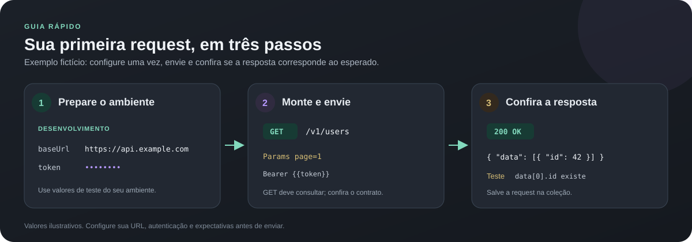
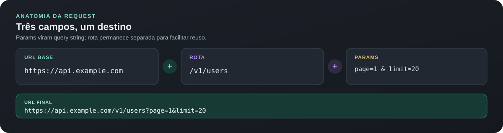
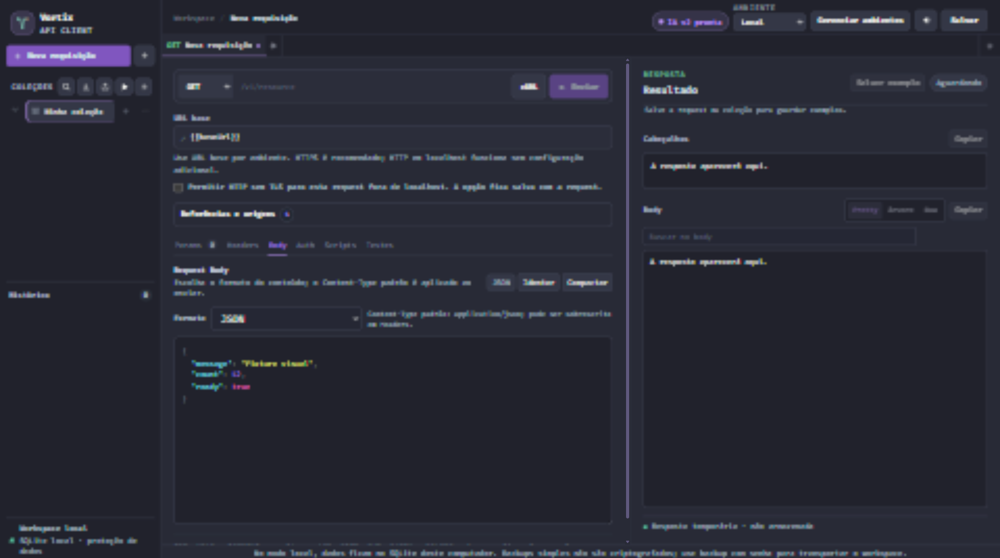
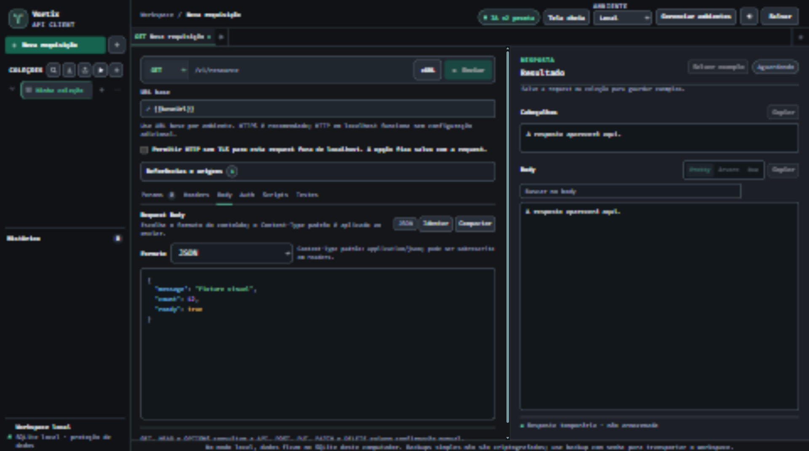
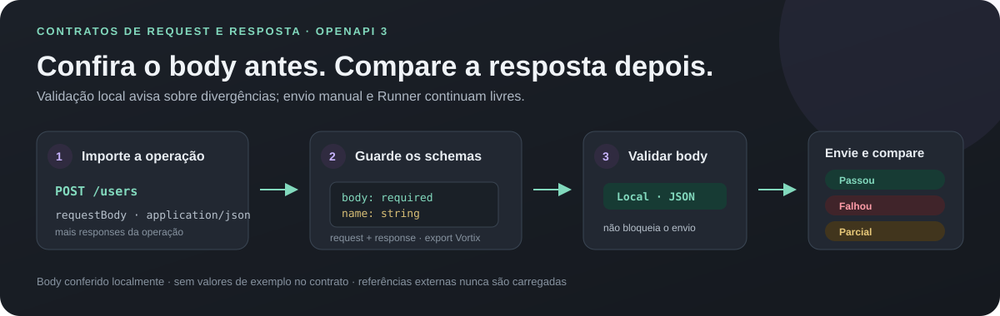

  

<h1 align="center">Vortix</h1>

Cliente HTTP agnóstico para criar, organizar, executar e repetir requisições de API.

ASP.NET Core 10 · SQLite local · IndexedDB no navegador

  

---

  

## Índice

- [Visão geral](#visão-geral)
- [Recursos](#recursos)
- [Requisitos](#requisitos)
- [Início rápido](#início-rápido)
- [Hospedagem pessoal no Render](#hospedagem-pessoal-no-render)
- [Primeiro fluxo](#primeiro-fluxo)
- [Compartilhamento e metadados públicos](#compartilhamento-e-metadados-públicos)
- [Busca rápida](#busca-rápida)
- [Execução revisada de requests salvas](#execução-revisada-de-requests-salvas)
- [Automação por IA com Maestri Portal](#automação-por-ia-com-maestri-portal)
- [Autenticação](#autenticação)
  - [Auth herdada por coleção e pasta](#auth-herdada-por-coleção-e-pasta)
  - [OAuth 2.0 Client Credentials](#oauth-20-client-credentials)
  - [Authorization Code with PKCE](#authorization-code-with-pkce)
- [Modos de body](#modos-de-body)
- [Multipart form-data](#multipart-form-data)
- [GraphQL](#graphql)
  - [Schema, confirmação e autocomplete](#schema-confirmação-e-autocomplete)
- [Importar cURL](#importar-curl)
- [Gerar comando cURL](#gerar-comando-curl)
  - [Gerar comando HTTPie](#gerar-comando-httpie)
  - [Importar HTTPie](#importar-httpie)
- [Importar OpenAPI JSON](#importar-openapi-json)
  - [Validar respostas com contrato OpenAPI](#validar-respostas-com-contrato-openapi)
- [Ambientes e variáveis](#ambientes-e-variáveis)
  - [Cofre local de segredos](#cofre-local-de-segredos)
- [Scripts, testes e Runner](#scripts-testes-e-runner)
  - [Runner CLI para CI/CD](#runner-cli-para-cicd)
  - [Histórico do Runner](#histórico-do-runner)
- [Importação e exportação](#importação-e-exportação)
  - [Exportar OpenAPI 3.1](#exportar-openapi-31)
- [Histórico de respostas](#histórico-de-respostas)
- [Persistência e backups](#persistência-e-backups)
- [Segurança](#segurança)
- [Configuração](#configuração)
- [Desenvolvimento e validação](#desenvolvimento-e-validação)
- [Contribuir](#contribuir)
- [Estrutura do projeto](#estrutura-do-projeto)
- [Solução de problemas](#solução-de-problemas)
- [Plano de ação](ROADMAP.md)
- [Licença](#licença)
- [Licenças das fontes](#licenças-das-fontes)

## Visão geral

Vortix é um cliente de APIs inspirado no fluxo de trabalho de ferramentas como Insomnia e Postman. O projeto é agnóstico: não inclui URL, rota, parâmetro, credencial ou regra de uma API específica.

A interface roda no navegador. Um servidor ASP.NET Core encaminha as requisições para a API escolhida, então o navegador não precisa acessar a API diretamente nem depender de CORS. No modo local, o workspace fica em SQLite no computador. No modo público, coleções, ambientes, requests, abas, configurações e histórico ficam no IndexedDB de cada perfil de navegador; o serviço não oferece contas nem sincroniza workspaces.

O modo público permite uso sem senha compartilhada. Cada navegador recebe uma sessão aleatória para isolar Cookie jars e fluxos OAuth temporários. O servidor não expõe o SQLite do workspace. O proxy limita chamadas e bloqueia destinos locais, privados e outros endereços não públicos.

## Recursos

- **Editor de requests:** GET, HEAD, POST, PUT, PATCH, DELETE e OPTIONS; URL base, rota, Params, Headers, body JSON/texto/XML/form URL-encoded/Multipart/GraphQL e Auth Bearer, Basic ou API Key.
- **Coleções:** coleções, pastas e subpastas para organizar requests.
- **Busca rápida:** encontre requests por texto ou filtre por método, status salvo e coleção/pasta usando `Ctrl+K`.
- **Ambientes:** variáveis próprias e Cookie jar isolado por ambiente, com substituição por templates como <code>{{baseUrl}}</code> e <code>{{token}}</code>.
- **Cofre local opcional:** segredos cifrados no navegador com PBKDF2-SHA-256 e AES-GCM-256, escopo por ambiente, bloqueio manual e uso por templates sem exibir valores.
- **Abas e histórico:** até 12 requests abertas; requests, status, duração e cabeçalhos filtrados ficam no SQLite local ou no IndexedDB do navegador. Bodies de resposta são opcionais e desativados por padrão.
- **Resposta:** visualização Pretty, Árvore ou Raw, cópia de cabeçalhos e body, busca, exemplos nomeados por request e simulação local sem chamar a API.
- **Captura de variáveis:** salve um campo JSON da resposta ou o texto completo no ambiente ativo.
- **OAuth 2.0:** Client Credentials e Authorization Code com PKCE S256; tokens salvos por ambiente com consentimento e proteção local.
- **Testes de resposta:** valide status HTTP, existência de campo JSON, igualdade ou presença de texto.
- **Runner:** execute requests de uma coleção ou pasta em sequência, com conjuntos de dados, intervalo, parada por falha, repetição das falhas e um histórico local seguro das rodadas.
- **Temas e fontes:** Papel (claro), Grafite, Maré, Dracula, Monokai, One Dark, Nord, Solarized Dark e GitHub Dark; Fira Code, JetBrains Mono, Cascadia Code, Cascadia Mono e IBM Plex Mono.
- **Editor JSON:** destaque de sintaxe e formatação com indentação de dois espaços.
- **Intercâmbio:** Vortix JSON, ambientes Postman, Insomnia v4, Postman Collection v2.1, cURL, HTTPie, importação de OpenAPI 3 e exportação de coleção como OpenAPI 3.1 JSON.
- **Backups:** exportação simples em JSON ou arquivo protegido por senha.

Requests novas começam vazias. A URL base e os demais valores vêm do ambiente e da configuração que você criar.

## Requisitos

- **.NET 10 SDK** para executar, compilar ou publicar o projeto.
- Navegador moderno com suporte a IndexedDB e Web Crypto.
- **Node.js 18 ou superior** para os testes de lógica JavaScript; **Node.js 20 ou superior** para o Runner CLI.
- **PowerShell e Python 3** para o teste integrado de proteção do SQLite.

A interface não exige npm nem framework JavaScript.

## Início rápido

### Windows

Na pasta do projeto, execute:

~~~powershell
.\VortixApiClient.cmd
~~~

O iniciador reutiliza uma instância Vortix que já responda no health check. Caso não exista, inicia o servidor e abre o navegador.

Os atalhos antigos Abrir-Testador-API.cmd, Abrir-Testador-API.ps1 e Validar-Testador.ps1 continuam disponíveis como wrappers de compatibilidade para os novos nomes Vortix.

### Outros sistemas ou execução manual

~~~sh
dotnet run --project ./VortixApiClient.csproj --no-launch-profile
~~~

Abra:

~~~text
http://127.0.0.1:51873/
~~~

Health check local:

~~~text
http://127.0.0.1:51873/health
~~~

O servidor usa a porta 51873 por padrão. Consulte [Configuração](#configuração) para alterá-la.

O endpoint <code>/health</code> preserva <code>app: ApiPublicacaoTester</code> para clientes antigos e informa <code>product: VortixApiClient</code> como identidade atual.

> [!TIP]
> Quer só experimentar? Inicie localmente e siga o [primeiro fluxo](#primeiro-fluxo). A seção do Render é apenas para hospedar uma cópia pública.

## Hospedagem pública no Render

O repositório inclui <code>Dockerfile</code> e <code>render.yaml</code> para criar um serviço web Render Free. O Vortix fica aberto para qualquer visitante, sem senha compartilhada. Cada perfil de navegador mantém workspace independente; o serviço encaminha as requests e não expõe dados de outros visitantes.

### Criar o serviço

1. Envie o repositório Vortix para o GitHub.
2. No Render, crie um **Blueprint** a partir do repositório e revise o serviço <code>vortix-api-client</code>. O Blueprint seleciona Docker e o plano Free.
3. Confirme <code>ApiStudio__PublicOrigin</code> com a origem HTTPS que você usará no navegador. O valor inicial do Blueprint é <code>https://vortixapiclient.jeffymesquita.dev</code>.
4. O Render fornece <code>PORT</code> ao container. Não fixe uma porta diferente no painel. O serviço escuta em <code>0.0.0.0</code> somente no modo hospedado.
5. Aguarde o deploy e confira o health check <code>/health</code>.

O Blueprint já declara <code>vortixapiclient.jeffymesquita.dev</code> como domínio personalizado. Se criar o serviço manualmente, adicione esse domínio nas configurações do Render. No provedor DNS do domínio, crie o CNAME para o destino exato exibido pelo Render. A configuração afeta apenas o host <code>vortixapiclient</code>; mantenha os registros do domínio raiz e de e-mail. O Render configura e renova TLS para o domínio personalizado. O valor de <code>ApiStudio__PublicOrigin</code> precisa coincidir com o domínio usado no navegador; divergência retorna HTTP 403 em <code>/api/session</code> e impede carregar o workspace. Consulte [domínios personalizados do Render](https://render.com/docs/custom-domains) e [Blueprints](https://render.com/docs/blueprint-spec).

O modo Render também aceita a URL <code>onrender.com</code> que a plataforma fornece, mesmo antes do CNAME do domínio próprio resolver. O host automático vem de <code>RENDER_EXTERNAL_HOSTNAME</code>; <code>RENDER_EXTERNAL_URL</code> também é aceito quando definido. A Redirect URI OAuth usa a origem aberta no navegador. Quando o DNS estiver configurado, o subdomínio próprio funcionará sem mudar a variável.

### Persistência e limites do plano Free

No modo público, o workspace fica diretamente no IndexedDB do navegador e continua lá quando Render reinicia. Os dados pertencem à origem e ao perfil de navegador; limpar dados do site, trocar de navegador ou usar outro dispositivo não transfere o workspace. Exporte um backup para migrá-lo. O IndexedDB não é criptografado automaticamente; use **Backup com senha** para criar um arquivo protegido.

O Render Free suspende serviços após 15 minutos sem tráfego, pode reiniciá-los e apaga arquivos locais ao dormir, reiniciar ou publicar uma nova versão. O primeiro acesso após suspensão pode levar cerca de um minuto. O plano Free não oferece disco persistente e a própria Render o recomenda para projetos de teste/hobby, não para aplicações de produção. Veja os [limites oficiais do plano Free](https://render.com/docs/free).

Qualquer pessoa poderá usar o proxy público. O limite por IP e o bloqueio de destinos privados reduzem abuso, mas não impedem consumo da cota gratuita por terceiros. Não use o plano Free como proxy crítico nem envie credenciais por HTTP sem TLS.

O SQLite temporário do serviço guarda apenas Cookie jars protegidos e isolados por uma sessão aleatória do navegador. Limpar os cookies do site pode iniciar um Cookie jar novo; reinício ou suspensão também pode apagar cookies e fluxos OAuth ainda abertos. Nenhum desses eventos apaga coleções ou histórico do IndexedDB.

O projeto e o container usam .NET 10 LTS. O suporte oficial vai até **14 de novembro de 2028**. Consulte a [política de suporte do .NET](https://learn.microsoft.com/en-us/dotnet/core/releases-and-support).

Como as requests são encaminhadas pelo servidor hospedado, ele só alcança endereços disponíveis a partir da rede do Render. <code>localhost</code>, <code>192.168.x.x</code> e outros endereços privados do computador não apontam para sua máquina e não serão acessíveis. Use o modo local para APIs da rede privada ou uma infraestrutura local/túnel separado.

Em hospedagem, o callback OAuth PKCE usa a origem pública configurada, não o callback loopback. Cadastre no provedor a URI exata mostrada pela aba **Auth** depois de publicar o domínio. Fluxos PKCE pendentes podem se perder quando o serviço gratuito suspende ou reinicia.

## Primeiro fluxo

  

Vamos montar uma consulta fictícia de usuários. Use um endpoint de teste seu quando repetir o fluxo; <code>api.example.com</code> abaixo é apenas exemplo.

### 1. Prepare um ambiente

Abra **Configurações → Ambientes**, crie **Desenvolvimento** e adicione:

| Variável | Valor de exemplo |
|---|---|
| <code>baseUrl</code> | <code>https://api.example.com</code> |

Se sua API exige Bearer, crie também <code>token</code> e use um token descartável neste exemplo. Vortix substitui <code>{{baseUrl}}</code> e <code>{{token}}</code> antes de enviar. No modo público, variáveis comuns ficam no IndexedDB sem criptografia automática; para guardar um segredo real, use o [cofre cifrado](#cofre-local-de-segredos). O proxy público recebe a request já montada para encaminhá-la à API, então use apenas um host em que confia.

### 2. Monte a request

Crie uma coleção e uma request **GET**. Separe cada parte nos campos do editor:

| Campo no Vortix | Valor |
|---|---|
| URL base | <code>{{baseUrl}}</code> |
| Rota | <code>/v1/users</code> |
| Params | <code>page=1</code> e <code>limit=20</code> |
| Header | <code>Accept: application/json</code> |
| Auth, se necessária | Bearer <code>{{token}}</code> |

O Vortix combina base, rota e Params. O resultado deste exemplo é:

  

Equivalente em cURL:

~~~sh
curl --request GET \
  --url 'https://api.example.com/v1/users?page=1&limit=20' \
  --header 'Accept: application/json'
~~~

O header Authorization é opcional: use-o só quando a API exigir autenticação. No Vortix, configure Auth como Bearer e referencie <code>{{token}}</code>; não cole um segredo real no texto da request.

Para testar o importador, cole esse comando em **Importar cURL** e confira os campos extraídos antes de enviar.

### 3. Envie, confira e reutilize

Clique **Enviar**. Uma resposta fictícia pode ter este formato:

~~~json
{
  "data": [
    { "id": 42, "name": "Ana", "active": true }
  ],
  "page": { "number": 1, "size": 20 }
}
~~~

Confira status e body; abra **Ver cabeçalhos da resposta** quando precisar dos metadados. Na aba **Testes**, você pode exigir status <code>200</code> ou verificar um campo da resposta, como <code>data[0].id</code>. GET costuma consultar dados, mas confira o contrato do endpoint: o Vortix não consegue garantir que uma API não altere estado. Salve a request na coleção para abrir de novo ou executar pelo [Runner de coleção](#runner-de-coleção). Se ainda não houver coleção, **Salvar** oferece criá-la explicitamente; cancelar mantém o rascunho.

Para enviar JSON, texto, XML ou form URL-encoded, escolha o formato na aba **Body**. O Vortix define o Content-Type padrão; um header Content-Type informado manualmente o sobrescreve. POST, PUT, PATCH e DELETE pedem confirmação de gravação; use dados descartáveis e confira a URL antes de confirmar.

## Compartilhamento e metadados públicos

A página inclui título, descrição, canonical, Open Graph e Twitter Card no HTML inicial. A prévia usa `wwwroot/social/vortix-og-v2.jpg`, derivada leve da arte original, com orçamento de até 200 KiB verificado nos testes; `robots.txt` e `sitemap.xml` apontam para a origem pública oficial. Nenhum valor do workspace ou da request entra nesses metadados.

Ao hospedar uma cópia com outro domínio, ajuste as URLs absolutas do head de `wwwroot/index.html`, `wwwroot/robots.txt` e `wwwroot/sitemap.xml` junto de `ApiStudio__PublicOrigin` e dos domínios em `render.yaml`. Depois de publicar, confira HTTP 200 e `image/png` no asset; a atualização da prévia em aplicativos de mensagem depende da nova leitura/cache de cada plataforma.

Veja [validação de SEO e prévia social](docs/superpowers/validation/2026-10-28-seo-social-preview.md).

## Busca rápida

Pressione `Ctrl+K` (ou `Cmd+K` no macOS) para abrir a busca global. Digite parte do nome, método, rota, coleção ou caminho da pasta; a busca ignora diferenças de acentuação. Use as setas para navegar e `Enter` para abrir a request em uma aba.

Os filtros podem ser combinados e também funcionam sem texto:

- **Método:** GET, HEAD, POST, PUT, PATCH, DELETE ou OPTIONS.
- **Status salvo:** status HTTP encontrado nos exemplos de resposta salvos nas coleções.
- **Coleção ou pasta:** limita a busca à coleção escolhida; uma pasta inclui também suas subpastas.

O status vem dos exemplos já salvos; a busca não envia requests nem altera o histórico. A lista mostra até 30 resultados por vez.

## Workspace desktop e aparência

O editor segue URL base, método/rota, abas de preenchimento e área **Enviar**, com a proteção de escrita junto da ação. **Ferramentas avançadas** reúne HTTP sem TLS, geração de cURL e referências; o indicador informa recursos ativos sem mostrar valores. **Execução revisada** mantém seu painel próprio. Recolher ferramentas não desativa automações já configuradas.

Na lateral, **Ferramentas da coleção** reúne importação, exportação e Runner. **Ajuda e exibição**, no cabeçalho, contém a ajuda do bridge e **Tela cheia**. **Configurações** organiza Aparência, Ambientes, Histórico e privacidade, Cofre e Backup/proteção em seções expansíveis. Segurança, consentimentos e avisos de persistência continuam nos respectivos fluxos.

Em **Configurações → Aparência**, há 11 temas: Dracula, Monokai, One Dark, Nord, Solarized Dark, GitHub Dark, Papel, Grafite, Maré, Aurora e Areia. **Aurora** combina uma superfície escura com destaque verde-água; **Areia** usa uma superfície clara e quente. A escolha é salva no workspace sem alterar fonte ou escala. Os temas incluem cores de sintaxe JSON, estados e foco por teclado.

O endereço fica em destaque, os dados mantêm as seis abas e a faixa de envio reúne ação e confirmações. A ajuda estática abre em popovers com botão **Fechar**; status, erros e consentimentos permanecem no fluxo. Params começa com uma linha vazia sem roubar o foco: essa linha não conta como parâmetro nem entra na URL. Preencher apenas o valor, sem nome, continua gerando erro.

As ações **Copiar** usam o ícone de dois retângulos, com nome acessível e título contextual. A confirmação **Copiado para a área de transferência** aparece como toast de informação somente após a cópia funcionar. Falhas continuam mostrando erro, sem confirmação falsa. A ponte IA descobre essas ações pelo contrato DOM, usando os mesmos handlers da interface.

O botão **Tela cheia** usa a Fullscreen API do navegador. Clique novamente ou pressione **Esc** para sair. O controle informa o estado por `aria-pressed`; fica desativado quando o navegador não oferece suporte e mostra um aviso se a solicitação for recusada. A disponibilidade depende do navegador e das permissões do portal.

As capturas abaixo usam somente conteúdo fictício em uma fixture local, sem banco pessoal ou execução de API. O antes representa `origin/master` em 1920×1080; o depois mostra o novo tema Grafite e a toolbar desktop.

| Antes | Depois |
|---|---|
|  |  |

## Execução revisada de requests salvas

Para retomar o desenvolvimento, consulte o [fichário de continuidade](docs/continuity.md), com entregas recentes, regras operacionais, evidências e a proposta da próxima rodada SDD.

No editor, abra **Execução revisada** para preparar uma request salva sem chamar a API. Salve alterações pendentes e confira o ambiente ativo antes de começar.

1. **Preparar salva:** resolve variáveis e ações locais uma vez; mostra destino, ambiente, quantidade de testes e efeitos de captura/histórico.
2. **Revisar e aprovar:** exige confirmação contextual inclusive para GET. Escritas também exigem a caixa de dados descartáveis e `TESTE`. Aprovar ainda não envia.
3. **Executar preparação:** consome a aprovação uma única vez e mostra HTTP, contagens de testes, captura e persistência. Uma validação parcial continua identificada como parcial.

A preparação expira em cinco minutos. Alterações relevantes invalidam a aprovação; prepare novamente. Auth não é persistida neste fluxo, sem mudar a preferência global do envio manual. Histórico, retenção de body e capturas seguem os efeitos revisados. Requests de token e multipart com arquivos efêmeros precisam do envio manual.

O controlador possui `prepare_request`, `execute_prepared` e `get_execution` internamente; não há endpoint ou ferramenta MCP nova. `window.vortixAgent` continua somente leitura. Agentes operam pelos controles visíveis; não invoque funções privadas ou o proxy diretamente.

Os identificadores e resumos de execução ficam em memória na aba. Recarregar perde esse registro; timeout ou perda de conexão não provam que a API deixou de executar uma escrita. Confira o destino antes de repetir. Não há recuperação durável ou reenvio automático. O resumo compacto omite payloads e credenciais; o resultado visual continua disponível na bancada, sem sobrescrever outra request aberta durante o envio.

Consulte o [guia completo da execução revisada](docs/structured-execution.md), com diagrama, seletores para agentes, recuperação de falhas e limites de segurança.

## Automação por IA com Maestri Portal

O Vortix expõe um contrato DOM versão 2 (`vortix-agent-contract: 2`) com nomes estáveis em `data-vortix-action` e `data-vortix-field`, regiões identificadas, abas ligadas aos painéis e `window.vortixAgent.describe()` / `snapshot()` para descoberta e estado seguro. O selo **Bridge v2 ativo** confirma que o bridge e o contrato compatível carregaram nesta página; não detecta se um agente está conectado ao Portal do Maestri. Clique para abrir a ajuda no app, copiar o prompt recomendado ou acessar os guias. O snapshot retorna metadados, incluindo status HTTP; omite URLs, valores de requisição, credenciais e conteúdo da resposta.

O [guia para agentes no Maestri Portal](docs/maestri-portal.md) traz um fluxo copiável para localizar controles, consultar estado seguro, preparar requests, ler respostas e seguir as proteções de escrita. No Maestri, conecte o Portal ao terminal do agente; o controle do navegador usa a CLI nativa, sem servidor MCP. Você também pode salvar o prompt como responsabilidade **Vortix Operator** em **Ajustes → Agentes**. O skill repo-local [vortix-maestri-operator](.agents/skills/vortix-maestri-operator/SKILL.md) orienta agentes que trabalham no repositório. Use o Portal para interagir com o Vortix; não chame o proxy da API diretamente nem tente contornar as confirmações da interface. O guia e o skill proíbem ler ou repetir credenciais e valores do cofre.

Use `window.vortixAgent.describe({ region: 'request-editor', includeState: true })` para descobrir somente a região necessária. Regiões desconhecidas retornam listas vazias; os estados expostos não comprovam consentimento.

Na ajuda de IA, **Copiar contexto seguro** copia somente o JSON de `snapshot()`, sem enviar requests. O contexto omite URLs, headers, body, credenciais e conteúdo da resposta; inclui metadados como método, contagens e status. Se o navegador bloquear o clipboard, um campo readonly com o JSON selecionado permite cópia manual. Confira o contexto antes de compartilhá-lo.

Para a execução revisada, `window.vortixAgent.diagnose()` oferece um resumo compacto; as vistas `{ view: 'blockers' }` e `{ view: 'result' }` trazem detalhes sob demanda. Estado antigo ou contexto diferente omite o resultado anterior e a próxima ação. A leitura não prepara, aprova ou envia requests. Veja [campos, limites e frescor do diagnóstico](docs/maestri-portal.md#diagnóstico-compacto-e-leitura-progressiva).

### Instalar a skill pelo skills.sh

A skill `vortix-maestri-operator` fica no repositório público e pode ser instalada pelo [CLI do skills.sh](https://skills.sh/docs/cli), sem publicação de pacote separado. O CLI requer Node.js 22.20 ou superior:

~~~sh
npx skills add https://github.com/JeffyMesquita/Vortix/tree/master/.agents/skills/vortix-maestri-operator --agent codex
~~~

O comando instala a skill no projeto atual para o Codex. Remova `--agent codex` para escolher outro agente compatível; acrescente `--global` para instalá-la no diretório do usuário, disponível entre projetos daquela máquina. O [skills.sh](https://skills.sh) usa instalações feitas pelo CLI para alimentar seu ranking e o badge acima.

## Modos de body

O editor mantém o body como texto e oferece formatos prontos:

  

| Formato | Content-Type padrão |
|---|---|
| JSON | <code>application/json</code> |
| Texto | <code>text/plain</code> |
| XML | <code>application/xml</code> |
| Form URL-encoded | <code>application/x-www-form-urlencoded</code> |
| Multipart | <code>multipart/form-data</code> com boundary automático |

Exemplos:

~~~json
{"name":"Ana","active":true}
~~~

~~~text
Texto livre para uma API que não recebe JSON.
~~~

~~~xml
<request><name>Ana</name></request>
~~~

~~~text
name=Ana&tag=one&tag=two
~~~

O formato acompanha a request nas abas, histórico, coleções e Runner. Vortix JSON o preserva; Postman e Insomnia recebem o formato e Content-Type correspondentes.

O JSON mantém destaque, indentação e compactação. Para texto, XML e form URL-encoded, o editor mostra o conteúdo sem destaque JSON. O header Content-Type manual pode substituir o padrão. GET, HEAD e OPTIONS continuam sem body.

Multipart e GraphQL têm seções próprias abaixo. Veja o [plano de ação](ROADMAP.md).

## Multipart form-data

  

Adicione campos de texto e arquivos à mesma request. Nomes repetidos e valores vazios são aceitos. O Vortix cria o <code>Content-Type</code> e o boundary; remova qualquer <code>Content-Type</code> manual em **Headers**, pois ele é rejeitado para evitar um boundary inválido.

Exemplo do metadata que o workspace preserva:

~~~json
[
  { "name": "title", "type": "text", "value": "Ana" },
  { "name": "avatar", "type": "file", "fileName": "avatar.png", "contentType": "image/png" }
]
~~~

| Parte | O que fica salvo | Ao reabrir |
|---|---|---|
| Texto | Nome e valor; valores com nomes sensíveis são omitidos conforme as regras do workspace. | Disponível para edição e envio. |
| Arquivo | Nome do campo, nome do arquivo e tipo MIME. Os bytes não são gravados em SQLite, histórico, backup nem exportação. | Selecione o arquivo novamente. |

O limite total por envio é **10 MB**. O arquivo fica em memória durante a chamada e segue pelo proxy local. A request é preservada em JSON Vortix, Insomnia v4 e Postman Collection v2.1 com os metadados; nenhum formato de exportação inclui os bytes do arquivo.

O Runner executa campos de texto. Requests com arquivos precisam ser enviadas manualmente depois de selecionar os arquivos novamente.

## GraphQL

  

Edite a query, as variables JSON e o **Operation Name** em campos separados. O Vortix envia um POST com <code>Content-Type: application/json</code>:

~~~graphql
query GetUser($id: ID!) {
  user(id: $id) { id name }
}
~~~

~~~json
{
  "id": "{{userId}}"
}
~~~

O payload enviado é montado pelo Vortix:

~~~json
{
  "query": "query GetUser($id: ID!) { user(id: $id) { id name } }",
  "variables": { "id": "42" },
  "operationName": "GetUser"
}
~~~

Variables precisam ser um objeto JSON. Se o campo ficar vazio, a propriedade <code>variables</code> não é enviada. Templates de ambiente dentro dos valores são resolvidos no envio. Query, variables e operationName ficam salvos na request, histórico e abas; o Runner também os preserva. Requests com método diferente de POST são recusadas.

O intercâmbio Postman Collection v2.1 usa o body GraphQL. Insomnia v4 recebe o envelope JSON de query. Importação e exportação preservam query, variables e operationName. Veja as referências oficiais de [GraphQL no Postman](https://learning.postman.com/docs/use/send-requests/protocols/graphql/graphql-http) e [GraphQL no Insomnia](https://developer.konghq.com/insomnia/graphql/).

### Schema, confirmação e autocomplete

No body GraphQL, informe URL base, rota, Auth e Params da API; clique **Carregar schema**. O Vortix mostra a URL e pede confirmação antes de qualquer consulta, inclusive em localhost. Envia somente uma query de introspecção read-only por POST; query/variables que você esteja editando não são enviadas. O endpoint usa Auth e Cookie jar do ambiente ativo. HTTP remoto continua bloqueado sem autorização na request.

O schema fica somente em memória: não entra no histórico, coleções ou SQLite. Se a API aceitar introspecção, escolha um tipo no seletor para navegar seus campos. Digite o prefixo de um campo na query e use as setas/Enter para completar; clicar em um campo do browser também o insere na posição atual do cursor. Alterar endpoint, ambiente, Params, Headers ou Auth invalida o schema carregado; consulte novamente. APIs que desativam introspecção retornam erro sem expor o body da resposta no toast.

`GraphqlIntrospection.test.ps1` valida o proxy com um mock GraphQL em loopback. O teste confirma que o servidor envia somente a query fixa de introspecção, encaminha Auth e não adiciona a consulta ao histórico. Não usa endpoint externo.

A request continua agnóstica: informe o endpoint GraphQL da API que você estiver usando.

### Métodos e proteção de gravação

Todos os métodos suportados estão disponíveis no seletor. POST, PUT, PATCH e DELETE exigem digitar <code>TESTE</code>, marcar a confirmação e aceitar a confirmação final do navegador. No Runner, gravações também exigem a frase e confirmações correspondentes.

Essa proteção é uma confirmação manual. O Vortix não consegue determinar se os dados ou o ambiente de destino são descartáveis. GET, HEAD e OPTIONS não aceitam body.

## Autenticação

  

A aba **Auth** oferece três formas comuns de autenticar requests. Selecione o tipo, preencha os campos e reutilize variáveis do ambiente, como <code>{{token}}</code>, <code>{{usuario}}</code> ou <code>{{apiKey}}</code>.

### Bearer

Use o token direto ou uma variável. O Vortix monta o header Authorization ao enviar:

~~~http
Authorization: Bearer {{token}}
~~~

### Basic Auth

Informe usuário e senha em campos separados. O Vortix cria o header Basic durante o envio; você não precisa codificar Base64 manualmente.

### API Key

Informe nome do campo, valor e local de envio. Prefira **Header**. A opção **Query Params** fica disponível para APIs que exigem esse formato e pede confirmação porque valores na URL podem aparecer em logs.

~~~http
X-API-Key: {{apiKey}}
~~~

### Auth herdada por coleção e pasta

  

Configure um padrão uma vez na coleção ou pasta. Requests novas começam em **Herdar**; a aba Auth mostra a origem, como **Herdada de Minha coleção**. Os campos ficam visíveis, mas bloqueados enquanto herdam.

A precedência é request personalizada > pasta mais próxima > coleção. Sem autenticação desativa a herança naquela request. Requests antigas sem `authMode` continuam personalizadas, preservando a configuração anterior.

Exemplo simplificado do JSON Vortix:

~~~json
{
  "auth": {
    "authType": "bearer",
    "bearerToken": "{{token}}"
  },
  "requests": [
    {
      "name": "GET /health",
      "route": "/health",
      "authMode": "inherit",
      "authType": "none"
    },
    {
      "name": "GET /public",
      "route": "/public",
      "authMode": "none",
      "authType": "none"
    }
  ]
}
~~~

O token fica no padrão da coleção, não é copiado para cada request nem para o histórico. O histórico guarda a referência da coleção/pasta e o ambiente da chamada, para reabrir Auth herdada no mesmo escopo. Se `{{token}}` varia entre ambientes, o Vortix resolve o valor do ambiente ativo ao enviar ou executar no Runner. Requests personalizadas continuam guardando seus próprios campos conforme a opção de salvamento.

### OAuth 2.0 Client Credentials

  

Use este fluxo para integração serviço a serviço, quando o cliente obtém acesso em nome próprio. Na aba <strong>Auth</strong>, abra <strong>OAuth 2.0 · Client Credentials</strong>, informe a URL completa do token endpoint, Client ID e scopes, e escolha a autenticação do cliente. O segredo é solicitado a cada envio.

O Vortix envia <code>POST</code> com <code>application/x-www-form-urlencoded</code>, <code>grant_type=client_credentials</code> e o scope opcional. <strong>HTTP Basic</strong> é o padrão; escolha <strong>Credenciais no formulário</strong> quando o servidor exigir <code>client_secret_post</code>. O segredo nunca vai na URL, no perfil salvo, nas abas ou no histórico. O perfil sem segredo é salvo por ambiente.

Exemplo de body para o método <code>client_secret_basic</code>:

~~~http
POST https://identity.example.com/oauth/token
Content-Type: application/x-www-form-urlencoded

grant_type=client_credentials&scope=read+write
~~~

Com <code>client_secret_post</code>, o formulário também contém <code>client_id</code> e <code>client_secret</code>. Os dois métodos não podem ser combinados. O Vortix aceita resposta JSON com <code>access_token</code> e <code>token_type: Bearer</code>; quando houver <code>expires_in</code>, mostra o vencimento. O token salvo opcionalmente como <code>{{token}}</code> fica no ambiente ativo com proteção local. Para request com Auth própria, o campo Bearer recebe o token; com herança ativa, o escopo herdado permanece.

A renovação é manual: solicite outro token quando o status indicar expiração. O Vortix não guarda <code>refresh_token</code>, não renova em segundo plano e não adiciona parâmetros proprietários como <code>audience</code>. O fluxo interativo <strong>Authorization Code with PKCE</strong> está descrito abaixo. Consulte o <a href="https://www.rfc-editor.org/rfc/rfc6749">RFC 6749, seções 4.4 e 5.1</a>.
### Authorization Code with PKCE

  

Use este fluxo quando a API precisa agir em nome de um usuário. Na aba **Auth**, abra **OAuth 2.0 · Authorization Code + PKCE** e informe a URL de autorização, URL do token endpoint, Client ID público e scopes. O fluxo **não aceita nem pede <code>client_secret</code>**.

Antes de autorizar, copie a **Redirect URI** exibida e cadastre exatamente esse valor no provedor. No modo local, a URI usa <code>http://127.0.0.1:&lt;porta&gt;/oauth/callback/&lt;identificador-do-provedor&gt;</code>. No modo hospedado, usa a origem HTTPS pública configurada, por exemplo <code>https://vortixapiclient.jeffymesquita.dev/oauth/callback/&lt;identificador-do-provedor&gt;</code>. Se mudar URL, tenant, porta ou origem pública, copie e cadastre a nova URI.

Ao clicar **Autorizar no navegador**, o Vortix gera <code>state</code> e <code>code_verifier</code> aleatórios, calcula <code>code_challenge</code> com <code>S256</code>, envia <code>code_challenge_method=S256</code> e abre o provedor em outra aba. Depois do login e consentimento, o provedor retorna o código ao callback configurado. O servidor valida <code>state</code>, caminho do provedor e prazo; então envia <code>grant_type=authorization_code</code>, <code>client_id</code>, o mesmo <code>redirect_uri</code>, <code>code</code> e <code>code_verifier</code> ao token endpoint. O verifier nunca aparece na URL de autorização, no histórico ou no SQLite.

Exemplo simplificado do token exchange:

~~~http
POST https://identity.example.com/oauth/token
Content-Type: application/x-www-form-urlencoded

grant_type=authorization_code&code=<codigo-de-uso-unico>&client_id=<client-id>&redirect_uri=<redirect-uri-exata>&code_verifier=<verifier-temporario>
~~~

As opções **Salvar access token** e **Salvar refresh token** vêm desmarcadas. Marque cada uma antes de iniciar para gravar <code>{{token}}</code> e/ou <code>{{refresh_token}}</code> no ambiente ativo. No modo local, o Vortix protege os valores no SQLite com ASP.NET Core Data Protection. No modo público, eles ficam no IndexedDB deste navegador sem criptografia automática; use backup com senha se precisar de uma cópia protegida. Sem consentimento, os tokens ficam apenas em memória durante o fluxo e são descartados ao terminar. Refresh token não é renovado automaticamente; a variável pode ser reutilizada manualmente. O botão **Cancelar autorização** invalida o fluxo ativo; se a aba do provedor permanecer aberta, feche-a. O callback redireciona para uma página limpa sem código ou state na URL final.

Os endpoints OAuth remotos precisam usar HTTPS. HTTP é aceito somente em loopback, para testes locais. O provedor deve aceitar Authorization Code para cliente público, PKCE <code>S256</code> e a redirect URI exata exibida pelo Vortix. Provedores que exigem <code>client_secret</code> ou não oferecem esse grant não funcionam neste fluxo. O Vortix não valida <code>id_token</code> nem implementa OpenID Connect; usa apenas access token Bearer e, se autorizado, refresh token.

Para cadastro e requisitos de segurança, consulte [RFC 7636](https://www.rfc-editor.org/rfc/rfc7636), [RFC 8252](https://www.rfc-editor.org/rfc/rfc8252), [RFC 9700](https://www.rfc-editor.org/rfc/rfc9700) e [RFC 10017](https://www.rfc-editor.org/rfc/rfc10017).

### Salvamento e intercâmbio

A opção **Salvar credenciais de Auth nas requests locais** controla histórico, abas e padrões de coleção/pasta. Desmarcada, o Vortix mantém esses valores só na sessão e não os grava nessas áreas. Templates pré-request têm uma autorização separada para salvar texto literal; referências como <code>{{tenant}}-{{request_id}}</code> podem ser guardadas sem valor literal. Sem essa autorização, ações com texto literal são omitidas de coleções, abas persistidas, histórico e backups; outras ações seguras continuam ativas. No modo público, texto autorizado fica no IndexedDB sem criptografia automática; use referências ao cofre para valores secretos. SQLite protege campos sensíveis com ASP.NET Core Data Protection.

Na importação, você escolhe se guarda credenciais. Na exportação, elas ficam fora por padrão. Marcar **Incluir credenciais de Auth e variáveis sensíveis** grava valores diretamente no JSON sem criptografia.

Vortix JSON e Postman Collection v2.1 preservam Auth de coleção/pasta e requests herdadas. Para manter a herança documentada no Insomnia, o Vortix exporta Auth de coleção numa pasta raiz chamada "Auth padrão"; as requests herdam da pasta.. Consulte a documentação oficial sobre [Auth em pastas no Insomnia](https://developer.konghq.com/insomnia/requests/) e [herança no Postman](https://learning.postman.com/latest-v-12/docs/use/send-requests/authorization/specifying-authorization-details).

## Importar cURL

O botão de importação aceita coleções JSON ou um comando cURL. Ao colar o comando, o Vortix apenas o interpreta: **não executa o comando nem envia a request**. O resultado abre como rascunho para revisão; salve-o depois em uma coleção.

Exemplo aceito:

~~~sh
curl --request PATCH \
  "https://api.example.com/v1/users/42?notify=true" \
  --header "Accept: application/json" \
  --header "Content-Type: application/json" \
  --data-raw '{"name":"Ana"}'
~~~

A importação converte método, URL, Params, headers e body. Também entende aspas simples/duplas e continuações de linha comuns do shell. O header Bearer vai para **Auth** e fica apenas em memória; marque a opção de salvamento se quiser persistir o token localmente.

A primeira versão aceita `-X`/`--request`, `-H`/`--header`, `--url`, `-d`/`--data`, `--data-raw`, `--data-binary`, `--json` e `-I`/`--head`. Body enviado sem método explícito vira POST; `--data` sem Content-Type recebe `application/x-www-form-urlencoded`.

O Vortix rejeita comandos com credenciais na URL, parâmetros de query sensíveis, autenticação Basic, cookies, upload de arquivo e opções não reconhecidas. Isso evita importar uma chamada alterada silenciosamente. Configure esses campos manualmente e importe a request novamente quando terminar.

## Gerar comando cURL

Na linha da request, clique em **cURL** para abrir uma prévia em **PowerShell (Windows)** ou **Bash / zsh**. A geração local não envia a request nem salva o comando. O clipboard só muda ao clicar em **Copiar cURL**.

Body, Auth, headers sensíveis e Params de query sensíveis são omitidos por padrão. Para incluí-los, marque **Incluir Body, Auth e campos sensíveis** e confirme. Valores então aparecem na tela e podem ser copiados; trate o comando como uma credencial e revise antes de colar ou compartilhar.

Templates como `{{baseUrl}}` e `{{token}}` não são resolvidos: Vortix não lê o ambiente nem o cofre para gerar o comando. Substitua esses templates no terminal. Ações pré-request não são executadas; body multipart, arquivos locais e Cookie jar também não entram na prévia. Configure esses itens manualmente no terminal.

Exemplo PowerShell:

~~~powershell
curl.exe `
  --request 'GET' `
  --url 'https://api.example.com/v1/users?page=2' `
  --header 'Accept: application/json'
~~~

Exemplo Bash / zsh:

~~~sh
curl \
  --request 'GET' \
  --url 'https://api.example.com/v1/users?page=2' \
  --header 'Accept: application/json'
~~~

### Gerar comando HTTPie

No seletor **Formato**, escolha **HTTPie**. A prévia usa o terminal escolhido acima e mantém as mesmas regras de segurança do cURL: Auth, Body e valores sensíveis ficam omitidos até confirmação. No PowerShell, o comando começa com `http.exe`; no Bash/zsh, com `http`.

HTTPie recebe o body literal por `--raw`. Requests com Body podem ser importadas de volta pelo Vortix; comandos `--auth` continuam exigindo configuração manual por segurança. A sintaxe oficial `--raw` envia o texto sem transformação ([documentação do HTTPie](https://httpie.io/docs/cli/request-data-via---raw)).

Headers com valor vazio usam a forma `Nome;`. API Keys em query são codificadas diretamente na URL.

Exemplo:

~~~sh
http --raw '{"name":"Ana"}' POST 'https://api.example.com/v1/users' 'Content-Type: application/json' 'Accept: application/json'
~~~

Templates continuam literais. Ações pré-request, body multipart, arquivos e Cookie jar não são convertidos para HTTPie.

### Importar HTTPie

No diálogo de importação, selecione **HTTPie** e cole o comando. O Vortix analisa a linha localmente e abre um rascunho; nunca executa o comando.

~~~sh
http GET https://api.example.com/v1/users page==1 Accept:application/json
http POST https://api.example.com/v1/users name=Ana age:=42
http --form POST https://api.example.com/v1/search term=Vortix
~~~

A importação reconhece método, URL, query com `==`, headers `Nome:valor`, campos JSON `nome=texto`/`nome:=JSON` e formulário simples com `--form`. O comando `https` escolhe HTTPS quando a URL não tem esquema. O Bearer em `Authorization` vai para **Auth** e fica apenas em memória.

Auth Basic, sessões, arquivos, fields/Params com nomes sensíveis, headers sensíveis e opções não suportadas são rejeitados sem repetir valores de credenciais no erro. Configure esses itens manualmente depois de abrir o restante da request.

## Importar OpenAPI JSON

Importe um documento OpenAPI 3.0, 3.1 ou 3.2 em JSON pelo botão de importação de coleções. O Vortix gera requests por operação, agrupa pela primeira tag, usa o primeiro servidor e converte parâmetros de path, query e header. Exemplos JSON da request viram body editável.

Exemplo mínimo:

~~~json
{
  "openapi": "3.1.1",
  "info": { "title": "Store API" },
  "servers": [{ "url": "https://api.example.com/v1" }],
  "paths": {
    "/users/{id}": {
      "get": {
        "tags": ["Users"],
        "summary": "Get user",
        "parameters": [{ "name": "id", "in": "path", "example": 42 }],
        "responses": { "200": { "content": { "application/json": {} } } }
      }
    }
  }
}
~~~

Variáveis de servidor com valor padrão são criadas em um ambiente OpenAPI. Quando <code>servers[].url</code> é apenas uma variável (por exemplo <code>{baseUrl}</code>), ela vira o <code>baseUrl</code> <code>{{baseUrl}}</code> da request, sem prefixo de rota, e o <code>default</code> correspondente é preservado no ambiente. Valores sensíveis e variáveis sem padrão ficam para configuração manual. Parâmetros sem exemplo ficam editáveis; variáveis de path sem exemplo aparecem como <code>{{nome}}</code>. Variáveis declaradas como segmentos de caminho em <code>servers[].url</code> permanecem dinâmicas no contrato de resposta; quando o servidor inteiro é uma variável, o prefixo de caminho da <code>baseUrl</code> ativa também permanece dinâmico. Confira a coleção gerada antes de enviar.

O importador não resolve referências de parâmetros ou segurança e nunca acessa a rede para buscar referências externas. Schemas JSON de `requestBody` e respostas aceitam referências locais limitadas. Body de mídia não JSON não recebe exemplo inicial e validação estrutural fica parcial. Requisitos de segurança continuam para configuração manual. A primeira versão aceita JSON; YAML ainda não é importado. Consulte também a <a href="https://spec.openapis.org/oas/latest.html">especificação OpenAPI</a>.

### Validar respostas com contrato OpenAPI

Ao importar uma operação OpenAPI com respostas descritas, o Vortix guarda o contrato junto à request. Abra a aba **Testes** para ver a indicação do contrato e envie manualmente ou execute pelo Runner. A validação compara o status HTTP, o `Content-Type` e, quando a resposta é JSON, a estrutura do body.

#### Validar body da request

Se a operação declarar `requestBody`, o Vortix também guarda o schema JSON da request. Na aba **Testes**, use **Validar body** para conferir o rascunho sem chamar a API. O envio manual e o Runner repetem essa validação com as variáveis resolvidas. Se `Content-Type` estiver ausente, a validação usa o padrão de `bodyMode` aplicado pelo proxy; uma linha explícita sem valor é inválida, como no envio. Em `multipart`, só os campos multipart contam como body; texto residual no editor não é enviado. O proxy gera o boundary e rejeita `Content-Type` manual para multipart. A validação estrutural de multipart fica parcial. Body vazio obrigatório, JSON inválido, mídia incompatível ou campos fora do schema aparecem como resultado de validação; **o resultado não bloqueia o envio**, porque você pode querer testar uma request inválida de propósito. No Runner, uma incompatibilidade do body aparece como aviso após a chamada e não conta como falha da etapa nem aciona **Parar após falha**. Essa opção continua valendo para falhas HTTP, testes da resposta e erros ao preparar ou enviar a request.

| Resultado do body | O que indica |
| --- | --- |
| **Passou** | Body vazio é permitido ou o JSON atende ao schema importado. |
| **Falhou** | Body obrigatório ausente, JSON inválido, `Content-Type` incompatível ou regra estrutural suportada não atendida. |
| **Parcial** | Referência ou schema incompleto, variável sem resolução ou conteúdo não JSON sem validação estrutural. |

Exemplo de request body importado:

~~~yaml
paths:
  /users:
    post:
      requestBody:
        required: true
        content:
          application/json:
            schema:
              type: object
              required: [name]
              properties:
                name: { type: string }
~~~

O contrato é local ao navegador, guarda schema e media types, não valores de `example`/`default`, e não é enviado ao proxy. Referências locais seguem os limites descritos acima; body não JSON retorna **Parcial** quando a validação estrutural não é suportada. Mensagens apontam o caminho do campo sem repetir valores enviados.

  

Exemplo da resposta esperada na especificação:

~~~yaml
paths:
  /users/{id}:
    get:
      responses:
        "200":
          content:
            application/json:
              schema:
                type: object
                required: [id, name]
                properties:
                  id: { type: integer }
                  name: { type: string }
~~~

O contrato acima aceita, por exemplo, `{"id": 42, "name": "Ava"}`. A validação não mostra nem persiste valores do body da resposta.

| Resultado | Quando aparece |
| --- | --- |
| **Passou** | Status, tipo de mídia e estrutura atendem ao contrato suportado. |
| **Falhou** | Status ou tipo de mídia não correspondem, o JSON é inválido ou uma regra estrutural falha. A mensagem identifica o caminho do campo, sem copiar seu valor. |
| **Parcial** | Método/rota não correspondem ou a especificação usa uma regra que o validador não interpreta. Não conte como sucesso: revise o contrato. |

O subconjunto estrutural cobre tipos, `nullable`, `required`, `properties`, `items`, `uniqueItems`, limites de números/textos/arrays/objetos e `additionalProperties`. `uniqueItems` compara objetos pela estrutura, sem depender da ordem das chaves, e `multipleOf` usa a precisão decimal dos valores. Contagens de propriedades acima do limite de validação ficam **Parciais** quando o limite do schema não pode ser decidido; uma violação comprovada pelo mínimo observado continua **Falhou**. A normalização preserva a versão OpenAPI: em 3.0, `nullable` e `exclusiveMinimum`/`exclusiveMaximum` booleanos seguem a semântica dessa versão; em 3.1 e 3.2 são aceitos tipos em união (como `['string', 'null']`) e limites exclusivos numéricos. Uma regra incompatível com a versão, schema ou mapa de respostas malformado, ou estrutura inválida de resposta/mídia deixa o resultado **Parcial** sem inventar uma reprovação. `$ref` local em respostas pode ser resolvido dentro de limites; referências externas nunca são carregadas. Enums, formatos, padrões, composição (`oneOf`/`allOf`/`anyOf`), `readOnly`/`writeOnly`, conteúdo XML/texto estruturado, ciclos e limites excedidos também deixam o resultado **Parcial** em vez de passar silenciosamente. Valores de `example`, `examples`, `default` e descrições não são copiados para o contrato. A request continua livre para edição; se método ou rota efetiva mudarem, a tela avisa que o contrato importado não se aplica à chamada atual.

## Ambientes e variáveis

Cada ambiente mantém suas próprias variáveis. Grupos ajudam a separar ambientes como Desenvolvimento, Homologação e Produção; os nomes e valores são definidos por você.

No cabeçalho, o seletor de ambiente fica ao lado do botão **Gerenciar ambientes**, que abre diretamente o diálogo de ambientes. A engrenagem continua abrindo as Configurações.

O Cookie jar também é separado por ambiente. Cookies recebidos em <code>Set-Cookie</code> são reutilizados quando domínio, caminho, HTTPS e validade correspondem. A lista mostra nome e metadados, nunca o valor; use **Limpar cookies deste ambiente** para removê-los. Excluir um ambiente também remove seu jar.

~~~http
Set-Cookie: session=exemplo; Path=/; Secure; HttpOnly; SameSite=Lax
~~~

O Vortix preserva SameSite como metadado. Como o envio é feito por um cliente HTTP local, regras de navegação de navegador para SameSite não são aplicadas.

Use <code>{{nomeDaVariavel}}</code> em URL base, rota, Params, Headers e Body. O Vortix substitui os templates antes do envio. Variáveis não definidas geram erro para evitar requests com valores incompletos.

Ao capturar uma variável de resposta, escolha o nome, a origem (campo JSON ou texto completo) e, para JSON, o caminho desejado. Por padrão, a captura ocorre apenas em respostas 2xx e salva o valor no ambiente ativo.

### Cofre local de segredos

O cofre é opcional e existe por ambiente. Abra **Configurações → Cofre de segredos**, defina uma senha de pelo menos 12 caracteres (máximo 256) e clique **Criar cofre**. Depois de desbloqueado, adicione nomes e valores; a lista mostra apenas os nomes. Use **Editar** para substituir um valor, **Remover** para excluir um nome e **Bloquear cofre** para descartar os valores descriptografados da memória desta aba. Recarregar a página também volta ao estado bloqueado.

O envelope persistido contém <code>ciphertext</code>, salt, IV, contagem de iterações e os nomes do índice — nunca o valor em texto claro nem a chave <code>CryptoKey</code>. Salt e IV são aleatórios; cada gravação e cada snapshot gera um IV novo. No modo local, o registro usa o SQLite existente; no modo público, usa o IndexedDB do navegador. Os dois caminhos passam por <code>dbRead</code>/<code>dbWrite('settings', …)</code>. Não há endpoint, tabela, autenticação de servidor nem senha compartilhada do cofre.

Use <code>{{nome}}</code> em URL base, rota, Params, Headers, Auth, Body, GraphQL e campos multipart. A precedência é: dados do Runner/dataset &gt; cofre &gt; variável do ambiente. As origens são registradas apenas como <code>environment</code>, <code>vault</code>, <code>dataset</code>, <code>missing</code>, <code>locked</code> ou <code>unavailable</code>; valores nunca entram no mapa de origens, no histórico, no relatório do Runner ou em toasts. O editor e o Runner exibem o inspetor de referências com campo, nome e origem, sem valores resolvidos. Se o cofre estiver bloqueado e o template citar um nome conhecido do índice, o envio falha com erro explícito antes de reutilizar um valor antigo do ambiente. Se a leitura do cofre falhar ou o envelope for inválido, o estado fica <code>unavailable</code> e o envio com templates é bloqueado; ausência real de registro continua significando que o ambiente não tem cofre.

Para capturar uma resposta diretamente no cofre, na aba **Scripts** escolha **Destino → Cofre cifrado**. A captura só ocorre com o cofre desbloqueado e o mesmo ambiente ativo; se estiver bloqueado, indisponível ou o armazenamento falhar, nada é gravado no ambiente (sem fallback). O valor capturado só se torna utilizável depois que o novo envelope é confirmado por <code>dbWrite</code>; se a gravação falhar, o cofre é bloqueado e o envelope persistido é recarregado quando possível. O destino padrão continua sendo o ambiente ativo, preservando o comportamento anterior.

**Backup:** o envelope opaco do cofre entra no backup simples e no backup com senha como qualquer outro registro de <code>settings</code>. Coleções e ambientes não recebem valores do cofre nem o envelope; um backup restaurado mantém o cofre bloqueado e exige a senha original. O backup protegido adiciona outra camada AES-GCM, mas não altera o envelope interno.

**Limites:** a senha do cofre não é armazenada nem recuperável; sem ela, os valores são inutilizáveis. Os nomes do índice podem aparecer em texto claro no envelope. Enquanto o cofre está desbloqueado, valores e chave existem em memória JavaScript; XSS, extensões do navegador, DevTools ou outro código na mesma origem podem lê-los. Bloquear/recarregar reduz a janela de exposição, mas a limpeza de memória em JavaScript não é garantida de forma criptográfica pelo coletor de lixo, e o sistema operacional pode manter cópias temporárias. O cofre protege o armazenamento em repouso no navegador, não uma sessão comprometida. A senha nunca é enviada ao servidor; por isso o cofre é por navegador/workspace e não é compartilhado entre dispositivos. Para transferir, use backup e informe a senha no outro navegador.

## Scripts, testes e Runner

### Captura de resposta

  

**Exemplo:** na request de autenticação, capture <code>access_token</code> para a variável <code>token</code>. Na próxima request, use <code>Authorization: Bearer {{token}}</code>. O valor fica no ambiente ativo e não precisa ser copiado entre chamadas.

~~~json
{
  "access_token": "valor-retornado-pela-api",
  "expires_in": 3600
}
~~~

Na aba **Scripts → Antes da request**, adicione ações ordenadas para gerar um **UUID**, um **timestamp UTC** ou um **template**. Os resultados existem só durante aquela chamada e podem ser usados em URL, Params, Headers, Auth, Body e campos GraphQL como <code>{{request_id}}</code>. Templates também podem usar valores de ações anteriores e variáveis do ambiente/cofre. Para guardar texto literal no template, marque **Autorizar salvar textos literais dos templates desta request**; sem isso, o Vortix remove o texto literal ao persistir.

Exemplo: gerar um ID e montar um header antes de enviar a request:

~~~json
{
  "route": "/orders/{{request_id}}",
  "headers": "X-Request-Label: {{request_label}}",
  "preRequestActionsEnabled": true,
  "preRequestActions": [
    { "type": "uuid", "name": "request_id" },
    { "type": "template", "name": "request_label", "value": "{{tenant}}-{{request_id}}" }
  ]
}
~~~

A prioridade é **dataset do Runner → ações pré-request → cofre → ambiente**. O Runner executa a lista para cada caso; o Runner CLI também aceita essas ações em coleções Vortix JSON v2. O histórico guarda a configuração autorizada das ações para reutilizar a request, mas nunca guarda os valores gerados. Use referências a variáveis do ambiente/cofre para credenciais; evite segredos literais nos templates.

Na seção **Depois da resposta → variável**, configure a captura de um valor, como <code>data.access_token</code>, para uma variável como <code>token</code>. Escolha o destino **Ambiente ativo** (padrão) ou **Cofre cifrado**. O cofre precisa estar desbloqueado e a falha de storage nunca copia o valor para o ambiente. O painel também mostra o código equivalente para o fluxo After-response do Insomnia, que pode ser copiado.

JavaScript importado nunca é executado pelo Vortix. Para ações pré-request, o importador reconhece somente scripts gerados pelo Vortix e sem alterações; as ações entram desativadas para revisão. Para captura de resposta, converte somente formas simples conhecidas de <code>insomnia.environment.set()</code> e <code>pm.environment.set()</code>. Scripts desconhecidos ou editados são ignorados e sinalizados. Ao exportar para Insomnia/Postman, o Vortix pede confirmação antes de incluir ações pré-request, captura e testes como scripts executáveis.

### Testes de resposta

A aba **Testes** permite até 20 verificações por request:

- status HTTP igual a um código;
- campo JSON existente;
- campo JSON igual a um valor;
- campo JSON contendo um valor.

Os testes rodam depois do envio manual e durante o Runner. Uma falha de teste marca a request como falha na rodada. Ao exportar testes ou captura para Insomnia/Postman, o Vortix pede confirmação para gerar scripts no arquivo.

Exemplo para uma resposta de criação:

~~~json
{
  "data": { "id": 42, "enabled": true },
  "tags": ["alpha", "beta"]
}
~~~

| Alvo | Caminho ou valor esperado | Regra |
|---|---|---|
| Status HTTP | <code>201</code> | Igual a |
| JSON | <code>data.id</code> | Existe |
| JSON | <code>data.enabled</code> | Igual a <code>true</code> |
| JSON | <code>tags</code> | Contém <code>beta</code> |

### Simular uma resposta salva localmente

Em **Exemplos salvos**, clique **Simular local** para mostrar um exemplo sem enviar a request ao proxy nem à API. A request atual precisa manter o mesmo método, caminho e query da request salva; a ordem dos parâmetros não importa, mas nomes e valores precisam corresponder. A simulação não cria servidor de mock e não entra no histórico. Os testes de resposta rodam normalmente; se a captura de variável estiver ativada, ela usa o body simulado e grava o resultado no ambiente ativo.

Exemplos úteis para uma mesma request:

| Cenário | HTTP | Body de exemplo |
|---|---:|---|
| Sucesso | 201 | <code>{"id":42,"name":"Ana"}</code> |
| Validação | 400 | <code>{"error":"validation_error","field":"email"}</code> |
| Erro do servidor | 500 | <code>{"error":"internal_error","requestId":"req-example"}</code> |

Salve cada resposta na mesma request e escolha **Simular local** para reproduzi-la.

### Runner de coleção

Selecione uma coleção ou pasta e clique em **Executar seleção**. O Runner percorre as requests em sequência e permite:

- fornecer até 100 conjuntos de variáveis JSON;
- definir intervalo entre requests;
- parar na primeira falha;
- executar novamente somente requests que falharam;
- acompanhar status, duração e resultado de cada request.

Exemplo de conjunto de dados JSON para o Runner:

~~~json
[
  { "userId": "101", "name": "Ana" },
  { "userId": "102", "name": "Rui" }
]
~~~

Use <code>/v1/users/{{userId}}</code> na rota e <code>{"name":"{{name}}"}</code> no body. O Runner substitui as variáveis em cada iteração. Segredos do cofre desbloqueado do ambiente ativo também podem ser usados; a precedência é dataset do Runner &gt; cofre &gt; ambiente. Com o cofre bloqueado, um nome conhecido do índice interrompe a resolução em vez de usar um valor antigo do ambiente. O plano e o resultado do Runner mostram as origens sem valores; cofre indisponível também bloqueia a resolução em vez de cair para o ambiente.

Cada rodada aceita até 500 requests. Credenciais solicitadas manualmente pelo helper de token permanecem no fluxo interativo e não são executadas pelo Runner. O relatório detalhado com bodies e mensagens continua temporário; o resumo seguro da rodada fica no histórico local do Runner.

### Runner CLI para CI/CD

O CLI executa uma exportação **Vortix JSON v2** em sequência, usa as mesmas funções de resolução e testes do Runner da interface e envia cada request pelo proxy Vortix local. Requer Node.js 20 ou superior e uma instância local do Vortix acessível por `127.0.0.1`; não envia credenciais a um proxy remoto.

~~~sh
node tools/vortix-runner.cjs \
  --collection ./smoke.vortix.json \
  --proxy http://127.0.0.1:51873 \
  --data ./datasets.json \
  --junit ./artifacts/vortix-results.xml \
  --map-var token=VORTIX_TOKEN
~~~

Defina `VORTIX_TOKEN` como secret no ambiente do job. `--map-var` recebe somente nomes; valores nunca vão em argumentos. Precedência: dataset &gt; ação pré-request &gt; mapeamento do processo &gt; variável capturada por resposta &gt; ambiente exportado. Capturas são compartilhadas só em memória e não substituem um valor mapeado no job.

O dataset é um array JSON de até 100 KB com até 100 objetos; cada execução aceita até 500 combinações de request e dataset. O arquivo JUnit precisa terminar em `.xml`, não pode apontar para arquivos de entrada ou do Runner e usa nomes genéricos de etapa, sem URLs, headers, bodies, dados de teste ou valores de variáveis. Código de saída `0` indica sucesso; `1`, falha HTTP ou de teste; `2`, erro de entrada/configuração; `130`, interrupção por Ctrl+C ou SIGTERM.

POST, PUT, PATCH e DELETE ficam bloqueados por padrão. Autorize gravações descartáveis somente com `--allow-writes --confirm-test-data TESTE`. HTTP fora de loopback exige `--allow-insecure-http` e que a própria request também tenha a permissão salva. Cookie jar usa um ambiente temporário por rodada e é removido ao terminar, inclusive quando Ctrl+C ou SIGTERM interrompem uma request. Redirecionamentos emitidos pelo proxy local não são seguidos.

O MVP aceita apenas Vortix JSON v2; executa as ações pré-request nativas, mas não JavaScript arbitrário nem requests multipart com arquivos salvos. Use `node tools/vortix-runner.cjs --help` para ver opções.

### Histórico do Runner

Ao final de cada rodada — concluída, parada na primeira falha ou interrompida por você — o Runner salva um resumo local com data, duração, totais e o resultado de cada etapa, incluindo as etapas não executadas. O histórico usa a chave `runnerHistory` em `settings` pelo mesmo `dbRead`/`dbWrite` do workspace: SQLite no modo local e IndexedDB no modo público. Mantém até 30 rodadas e limita o conjunto a 750 KB; rodadas grandes fazem as mais antigas saírem antes de alcançar o limite de gravação do SQLite.

O snapshot guarda apenas `id`, `startedAt`, `durationMs`, `total`, `passed`, `failed`, `skipped`, `stopped` e `steps` com `ordinal`, `outcome`, `status`, `durationMs`, `testsPassed` e `testsFailed`. URLs, rotas, nomes de requests, headers, bodies, datasets, labels de testes e mensagens de erro nunca são persistidos. O mesmo allowlist é aplicado ao exportar e ao restaurar backups.

Abra o Runner para ver a lista compacta. Cada item mostra a data e o resumo; as primeiras 60 etapas aparecem de imediato e **Mostrar etapas restantes** revela as demais, até o limite de 500 por rodada. Leitores de tela recebem um resumo curto do histórico, sem anunciar a lista inteira a cada atualização. Ao abrir, o Runner normaliza snapshots legados e grava IDs estáveis antes de permitir exclusões. Use **Excluir** para remover uma rodada ou **Limpar histórico** para apagar todas. O Vortix serializa gravações, exclusões e limpeza entre abas com o lock do navegador; quando Web Locks não está disponível, a interface avisa para editar o histórico em uma aba por vez. Se a leitura ou a gravação falhar, a execução continua e o Vortix mostra um aviso para conferir o armazenamento do workspace antes de tentar novamente.

## Importação e exportação

| Formato | Importar | Exportar |
|---|:---:|:---:|
| Vortix JSON v2 | Sim | Sim |
| API Studio JSON legado v1/v2 | Sim | — |
| Insomnia Export JSON v4 | Sim | Sim |
| Postman Collection v2.1 | Sim | Sim |
| Comando cURL | Sim | - |
| OpenAPI 3.0/3.1/3.2 JSON | Sim | OpenAPI 3.1, em JSON |
| Ambiente Postman JSON | Sim | Sim, por ambiente |

Na importação, o Vortix pede confirmação antes de guardar credenciais Bearer, Basic, API Key e variáveis sensíveis com proteção local. A exportação omite credenciais por padrão; se marcar a opção, o JSON poderá conter esses valores sem criptografia. Cookies e chaves privadas continuam fora do export.

### Exportar OpenAPI 3.1

No diálogo **Exportar coleção**, escolha **OpenAPI 3.1** para baixar um arquivo `*.openapi.json` com `openapi: "3.1.0"`, `info.title` igual ao nome da coleção e `info.version` fixa. O builder recebe apenas a coleção sanitizada e as variáveis não sensíveis do ambiente ativo; não há controles adicionais de título ou versão.

O documento inclui método, path e nomes de parâmetros de path/query/header. Todo `{{param}}` ou `{param}` no path vira um parâmetro `in: "path"` obrigatório. Placeholders são canonicalizados pela posição no path: nomes diferentes na mesma posição viram um único path e compartilham o nome canônico do parâmetro, permitindo métodos diferentes nesse path. Parâmetros de query repetidos geram um único parâmetro por nome. `Accept` define os tipos em `responses.default.content` e `Content-Type` escolhe `requestBody.content`, sempre com media types HTTP válidos; wildcards `*/*` e `tipo/*` são aceitos somente em `Accept`. Media type inválido em `Accept` é omitido; em `Content-Type`, o body usa o padrão do modo com um aviso genérico, e o header nunca é emitido como parâmetro. Todo body produz um schema inferido de sua estrutura, sem valores literais, e campos sensíveis são omitidos. Toda operação tem `responses` não vazio, com resposta `default` genérica quando não há uma resposta específica representável. Requests repetidas com o mesmo método e path canônico interrompem a exportação para evitar descartar operações silenciosamente.

Servidores com `{{var}}` são convertidos para a forma OpenAPI `{var}` e recebem `default` somente quando a variável ativa correspondente existe, não tem nome sensível e a URL HTTP(S) resultante é válida, sem usuário, senha, query ou fragmento. Caso contrário, o arquivo usa o placeholder seguro `https://api.example.test` e mostra um aviso. Credenciais e valores de variáveis com nomes sensíveis não são exportados. URLs, paths e nomes ainda podem revelar contexto interno; revise o arquivo antes de compartilhar.

O OpenAPI 3.1 não inclui valores de Auth, body ou resposta. Auth é exportada apenas como metadados de esquema (`bearer`, `basic` ou `apiKey`) e, quando possível, um `security requirement`. Headers, query values, scripts, cookies e valores de exemplo não são representados. O documento inclui o nome da coleção, URLs de servidor, paths e nomes de parâmetros/campos; eles podem revelar identificadores ou contexto interno. Antes de compartilhar, revise o arquivo baixado e os avisos que aparecem antes do download. O formato também não preserva integralmente:

- exemplos e respostas salvas, scripts, ações pré-request, testes e captura de variáveis;
- cookies e Cookie jar;
- arquivos e valores de multipart, que viram um `requestBody` genérico;
- query, variables e `operationName` de GraphQL;
- hierarquia de pastas aninhadas, achatada em tags;
- conteúdo textual ou XML não mapeável, representado somente como schema genérico.

Auth permanece apenas como metadados de esquema, sem valores. A exportação OpenAPI não altera os formatos Vortix, Insomnia ou Postman e não envia requests nem grava o rascunho.

Em **Configurações → Ambientes**, clique em **Exportar** no ambiente desejado para baixar um `*.postman_environment.json` independente. Postman e Insomnia aceitam esse formato para importar ambientes. O Vortix detecta possíveis segredos pelo nome da variável e os omite por padrão; revise os valores antes de compartilhar. Para incluí-los, confirme a inclusão e o aviso sobre o arquivo sem criptografia. As entradas incluídas usam `type: "secret"` para serem mascaradas no Postman, mas seus valores continuam legíveis no JSON. Cookies, chaves privadas e o cofre de segredos nunca entram no arquivo. O formato Postman não guarda os grupos do Vortix; ao importar, o ambiente entra no grupo **Importado**. A exportação usa somente os valores visíveis no formulário e não salva o rascunho.

Exemplo sem valores sensíveis:

~~~json
{
  "id": "a3e8c074-b0d7-4e25-b9f2-118b8c2eb334",
  "name": "Desenvolvimento",
  "values": [
    { "key": "baseUrl", "value": "https://api.example.com", "type": "default", "enabled": true },
    { "key": "tenantId", "value": "", "type": "default", "enabled": true }
  ],
  "_postman_variable_scope": "environment",
  "_postman_exported_at": "2026-10-20T12:00:00.000Z",
  "_postman_exported_using": "Vortix"
}
~~~

Veja os guias oficiais para [exportar ambientes no Postman](https://learning.postman.com/docs/use/send-requests/variables/team-environments/) e [importar coleções e ambientes Postman no Insomnia](https://developer.konghq.com/how-to/migrate-collections-and-environments-from-postman-to-insomnia/). Revise o conteúdo antes de compartilhar qualquer arquivo JSON.

Insomnia v4 e Postman Collection v2.1 preservam os exemplos de resposta vinculados a cada request. No Postman, eles usam `response[]`; no Insomnia v4, recursos `_type: response` referenciam a request por `parentId`. Ao exportar coleções com exemplos, o Vortix pede confirmação porque os bodies seguem sem criptografia no arquivo. Headers de autenticação, cookies e outros headers sensíveis são filtrados. Exports Insomnia e Postman também podem conter scripts Pre-request e After-response/Post-response para ações, captura e testes; o Vortix pede confirmação antes de exportá-los. Sem inclusão de credenciais, templates com texto literal são omitidos e as demais ações seguras permanecem ativas. Revise o arquivo e os scripts antes de importá-lo em outro cliente.

## Histórico de respostas

Cada envio manual salva status HTTP, motivo, duração e cabeçalhos de resposta filtrados no histórico da request. Clique no selo de status no painel **Histórico** para restaurar a resposta na área de resultado.

O limite padrão mantém as 500 requests mais recentes. Em **Configurações → Histórico de respostas**, escolha 50, 100, 250, 500, 1000 ou 2500. Reduzir o limite pede confirmação e remove os registros mais antigos, incluindo responses já salvos.

O body de resposta não é salvo por padrão. Ative **Salvar body de resposta** para requests futuras. No modo local, o SQLite protege esses bodies com ASP.NET Core Data Protection; no modo público, eles ficam no IndexedDB sem criptografia automática. Bodies acima do limite local não são guardados. Desativar a opção não apaga bodies antigos; use **Limpar histórico** para removê-los. Bodies de respostas de endpoints de token nunca são guardados, mesmo com a opção ativa. Cabeçalhos de autenticação, cookies, tokens e chaves também ficam fora do snapshot.

Valores resolvidos do cofre de segredos são substituídos por <code>{{segredo}}</code> no body, motivo e valores dos cabeçalhos salvos no histórico. O Runner também os oculta do body, status e mensagens de erro exibidos nos resultados.

Marque duas respostas no **Histórico** e clique **Comparar respostas**. A janela mostra status, duração, headers filtrados e bodies salvos lado a lado; o resumo destaca quais dados mudaram. Se algum body não foi guardado, a comparação continua com status, duração e headers. Bodies de token nunca são mostrados.

Backups do workspace incluem histórico e bodies que você escolheu salvar. O histórico do Runner entra apenas como resumo permitido, sem URLs, bodies, headers, datasets ou mensagens de erro. O backup simples não é criptografado; use **Backup com senha** para proteger o arquivo.

## Persistência e backups

No modo local, histórico, coleções, pastas, ambientes, Cookie jars, requests, abas e configurações ficam em um banco SQLite no computador. Valores de cookies são protegidos com Data Protection. O body das respostas fica temporário até você salvar explicitamente um exemplo na request. Requests e variáveis podem conter dados sensíveis, portanto proteja o computador e os backups.

No modo público, histórico, coleções, pastas, ambientes, requests, abas e configurações ficam no IndexedDB do perfil de navegador atual. O workspace não é enviado ao SQLite do serviço. O navegador mantém os dados entre visitas, mas limpar os dados do site pode removê-los; faça backups regulares. O conteúdo do IndexedDB não é criptografado automaticamente.

Exemplos de resposta salvos ficam anexados à request da coleção, com status, body e headers filtrados. No modo local, Data Protection protege o body no SQLite; no modo público, ele fica no IndexedDB do navegador. Vortix JSON, Insomnia v4 e Postman Collection v2.1 preservam os exemplos. Os exports JSON não são criptografados e podem conter dados reais da resposta, então revise e confirme antes de compartilhar.

Em Windows, sem configuração personalizada, o banco fica em:

~~~text
%LOCALAPPDATA%/ApiPublicacaoTester/api-studio.sqlite
~~~

O projeto, executável e launcher usam o nome <code>VortixApiClient</code>. O diretório de dados legado permanece <code>ApiPublicacaoTester</code> e a identidade de Data Protection permanece <code>ApiPublicacaoTester</code>; isso mantém acesso ao SQLite e aos valores já protegidos. O nome antigo do IndexedDB também continua reconhecido para a migração inicial.

Em outros sistemas, o diretório parte de <code>Environment.SpecialFolder.LocalApplicationData</code>. O caminho pode ser definido com <code>ApiStudio__DatabasePath</code>.

Na primeira execução, o Vortix tenta importar os dados antigos do IndexedDB do navegador. A cópia antiga é preservada no navegador; se a migração falhar, os dados permanecem disponíveis para nova tentativa.

### Proteção de dados

O SQLite inteiro não é criptografado. ASP.NET Core Data Protection protege campos reconhecidos como sensíveis e bodies não vazios. A proteção depende do key ring e da identidade que executa o aplicativo. Mantenha acesso às chaves ao mover o banco ou trocar a identidade do processo. Se uma chave antiga não estiver disponível para descriptografar a preferência não secreta `tokenCredentialMode`, o Vortix usa `body`, mantém o ciphertext original e mostra um aviso. Outros valores protegidos continuam exigindo o key ring original.

As credenciais de Auth seguem a opção de salvamento da request ou do histórico. No helper **Solicitar token**, client_id/client_secret são pedidos a cada envio e não entram no histórico.

### Backup do workspace

Em **Configurações → Backup do workspace**, escolha:

- **Backup simples:** JSON sem criptografia. Pode conter dados sensíveis.
- **Backup com senha:** arquivo protegido com AES-GCM de 256 bits e chave derivada por PBKDF2-SHA-256. Exige senha de pelo menos 12 caracteres; a senha não é salva nem recuperável.

A restauração substitui o workspace local, incluindo histórico, coleções, ambientes e configurações. Faça um backup antes e guarde a senha do arquivo protegido separada dele. Se houver cofre de segredos, o envelope cifrado é preservado como dado opaco; ele continua exigindo a senha original e não é misturado às variáveis de ambiente nem às coleções.

## Segurança

- No modo local, o serviço escuta somente em <code>127.0.0.1</code>; os endpoints também validam origem e host. Não exponha esse modo à rede local ou à internet.
- No modo público, cada visitante usa workspace próprio no IndexedDB do perfil atual. SQLite de workspace, autenticação e backup automático compartilhado ficam desativados. Cookie jars e fluxos OAuth temporários usam uma sessão aleatória <code>HttpOnly</code>, <code>Secure</code> e <code>SameSite=Lax</code>.
- Cookie jars hospedados ficam limitados a 256 KiB por sessão e 4 MiB no serviço. Sob pressão, o Vortix remove jars das sessões menos recentemente gravadas; exporte o backup do navegador se precisar preservar cookies por longo prazo.
- O proxy público limita endpoints de rede a 30 chamadas por minuto por IP encaminhado pelo Render e bloqueia loopback, rede privada, link-local, multicast, documentação e outros endereços IP não públicos para reduzir risco de SSRF. Redirecionamentos HTTP não são seguidos.
- Render Free é um plano de hobby/teste, não uma hospedagem de produção. O serviço pode dormir e perder o SQLite temporário; mantenha backups exportados e não dependa dele como único armazenamento.
- O proxy hospedado envia requests a partir da rede do Render. Ele não alcança <code>localhost</code> nem a rede privada do computador.
- HTTPS é recomendado para a API de destino. HTTP em localhost funciona; HTTP em outros hosts exige habilitação explícita na request e confirmação antes do envio. HTTP não cifra tokens, headers ou body.
- O Vortix valida URL base e rota, não permite trocar de host pela rota e bloqueia alguns cabeçalhos de transporte. Redirecionamentos HTTP não são seguidos automaticamente.
- Configure a autenticação na aba **Auth**. O Vortix gera o header Authorization para Bearer e Basic; não informe esse header manualmente.
- O cofre local é opcional e usa PBKDF2-SHA-256 + AES-GCM-256 no navegador. A senha nunca é enviada nem salva. Enquanto desbloqueado, os valores ficam em memória JavaScript e podem ser lidos por XSS, extensões, DevTools ou qualquer código da mesma origem; bloqueie ao terminar. A limpeza após lock/reload remove as referências da aplicação, mas o garbage collector e o sistema operacional não oferecem garantia criptográfica de apagamento imediato da memória.
- Backups simples preservam o envelope opaco do cofre; eles não descriptografam segredos nem os copiam para coleções ou ambientes. O backup com senha protege o arquivo inteiro, mas a senha do cofre continua necessária para abrir o envelope restaurado.
- Requests importadas não executam scripts arbitrários.
- Arquivos SQLite, key rings, configurações locais e segredos estão excluídos pelo <code>.gitignore</code>. Não remova essas regras ao preparar um fork ou publicação.

## Configuração

O aplicativo lê as configurações ASP.NET Core por variáveis de ambiente:

| Variável | Padrão | Descrição |
|---|---|---|
| <code>ApiStudio__Port</code> | <code>51873</code> | Porta local. Aceita valores de 1 a 65535. |
| <code>PORT</code> | fornecido pelo Render | Porta do container hospedado. O modo <code>render</code> também aceita um valor entre 1 e 65535 e escuta em todas as interfaces do container. |
| <code>ApiStudio__HostingMode</code> | <code>local</code> | Use <code>render</code> para ativar acesso público, origem HTTPS, proxy com bloqueio de destinos privados e workspace por navegador. |
| <code>ApiStudio__PublicOrigin</code> | vazio no modo local | Obrigatória no modo <code>render</code>. Origem HTTPS exata usada no navegador, sem caminho, query ou fragmento. |
| <code>ApiStudio__OAuthPkceFlowTimeoutSeconds</code> | <code>300</code> | Tempo máximo de um fluxo PKCE pendente, de 1 a 600 segundos. |
| <code>ApiStudio__DatabasePath</code> | LocalApplicationData + <code>ApiPublicacaoTester/api-studio.sqlite</code> | Caminho completo do SQLite local; no Render, o banco temporário guarda Cookie jars por sessão. A identidade do processo precisa ter permissão de leitura e escrita. |

Exemplo no PowerShell:

~~~powershell
$env:ApiStudio__Port = '51874'
$env:ApiStudio__DatabasePath = 'D:/VortixData/api-studio.sqlite'
dotnet run --project ./VortixApiClient.csproj --no-launch-profile
~~~

As variáveis valem para o processo iniciado nesse terminal.

## Desenvolvimento e validação

~~~powershell
dotnet restore ./VortixApiClient.csproj
dotnet build ./VortixApiClient.csproj -c Release
node --test ./RunnerLogic.test.cjs ./VortixRunner.test.cjs ./AIFriendlyUi.test.cjs ./AIAgentBridge.test.cjs ./StructuredExecution.test.cjs ./StructuredRequest.test.cjs ./StructuredUi.test.cjs ./StructuredIntegration.test.cjs
powershell -NoProfile -ExecutionPolicy Bypass -File ./HostingMode.test.ps1
powershell -NoProfile -ExecutionPolicy Bypass -File ./WorkspaceProtection.test.ps1
powershell -NoProfile -ExecutionPolicy Bypass -File ./AuthorizationCodePkce.test.ps1
powershell -NoProfile -ExecutionPolicy Bypass -File ./HistoryRetention.test.ps1
powershell -NoProfile -ExecutionPolicy Bypass -File ./GraphqlIntrospection.test.ps1
~~~

O teste integrado precisa de Python 3 acessível como <code>python</code>. Ele cria um SQLite temporário, inicia uma instância local isolada e remove a pasta temporária ao finalizar.

Com o Vortix já em execução, valide a página e os endpoints locais:

~~~powershell
powershell -NoProfile -ExecutionPolicy Bypass -File ./Test-VortixApiClient.ps1
~~~

## Contribuir

Contribuições são bem-vindas. Consulte o [guia de contribuição](CONTRIBUTING.md) e o [código de conduta](CODE_OF_CONDUCT.md). Use os formulários de [bug](https://github.com/JeffyMesquita/Vortix/issues/new?template=bug_report.yml) e [ideia](https://github.com/JeffyMesquita/Vortix/issues/new?template=feature_request.yml); o [template de pull request](.github/PULL_REQUEST_TEMPLATE.md) descreve as evidências e validações esperadas. Para vulnerabilidades, leia o [guia de segurança](SECURITY.md).

Pull requests passam pela validação automática de build e testes em Windows. Não inclua tokens, senhas, URLs privadas, dados reais de requests, bancos SQLite ou chaves locais em issues, commits e capturas de tela.

## Estrutura do projeto

| Caminho | Responsabilidade |
|---|---|
| <code>Program.cs</code> | Host ASP.NET Core, proxy de requests, endpoints locais e validações HTTP. |
| <code>LocalDataStore.cs</code> | Persistência SQLite, proteção de valores e backups do workspace. |
| <code>wwwroot/index.html</code> | Estrutura da interface. |
| <code>wwwroot/app.js</code> | Editor, coleções, ambientes, histórico e fluxos da interface. |
| <code>wwwroot/agent-bridge.js</code> | API DOM somente leitura para descoberta de controles e snapshot seguro. |
| <code>wwwroot/runner-logic.js</code> | Lógica sem dependência de DOM, importação, validação e Runner. |
| <code>.agents/skills/vortix-maestri-operator/SKILL.md</code> | Skill repo-local para operar Vortix pelo Maestri Portal com limites de segurança. |
| <code>wwwroot/style.css</code> | Layout, temas, tipografia e estados visuais. |
| <code>VortixApiClient.csproj</code> | Nome do projeto e artefatos de build. |
| <code>VortixApiClient.ps1</code> | Inicializa ou reutiliza a instância local. |
| <code>VortixApiClient.cmd</code> | Atalho de inicialização no Windows. |
| <code>Dockerfile</code> | Imagem de produção para o serviço hospedado Render. |
| <code>render.yaml</code> | Blueprint com o serviço Render Free e variáveis públicas/secretas. |
| <code>Test-VortixApiClient.ps1</code> | Smoke check contra uma instância em execução. |
| <code>HostingMode.test.ps1</code> | Testa hostname Render, isolamento de sessões/OAuth, validação e quotas dos Cookie jars, restore em lote, bloqueio de destinos privados, origem e rate limit. |
| <code>HistoryRetention.test.ps1</code> | Testa limite do histórico e proteção do body SQLite. |
| <code>GraphqlIntrospection.test.ps1</code> | Testa introspecção fixa contra mock local. |
| <code>GraphqlSchemaCaptureServer.test.ps1</code> | Mock GraphQL loopback para o teste integrado. |
| <code>RunnerLogic.test.cjs</code> | Testes de lógica JavaScript. |
| <code>AIFriendlyUi.test.cjs</code> | Contrato DOM, abas acessíveis e guia para agentes do Maestri Portal. |
| <code>AIAgentBridge.test.cjs</code> | Testa o snapshot seguro do bridge DOM do Vortix, incluindo ausência de valores sensíveis. |
| <code>WorkspaceProtection.test.ps1</code> | Teste integrado de persistência e proteção em banco temporário. |
| <code>AuthorizationCodePkce.test.ps1</code> | Teste local de callback, state, PKCE, cancelamento e expiração. |
| <code>OAuthAuthorizationServer.test.ps1</code> | Provedor OAuth fictício de loopback para testes. |

## Solução de problemas

### A porta 51873 já está em uso

Defina <code>ApiStudio__Port</code> para outra porta livre e abra o novo endereço local. O helper do Windows só reutiliza a instância existente quando o health check identifica o Vortix.

### Uma request não chega à API

Confira URL base, rota, método, Params, headers e autenticação. Para HTTP fora de localhost, habilite a opção de HTTP inseguro somente naquela request; prefira HTTPS.

### O envio de gravação é bloqueado

POST, PUT, PATCH e DELETE exigem digitar exatamente <code>TESTE</code>, marcar a confirmação e aceitar a confirmação final. O Runner aplica as próprias confirmações de gravação.

### Dados protegidos não abrem após mover a instalação

Verifique se o banco e o key ring do ASP.NET Core Data Protection foram preservados e se o processo continua usando a identidade correta. Faça backup antes de mudar a identidade do pool ou a localização dos dados.

### Um importador informa que scripts não foram convertidos

O Vortix não executa JavaScript arbitrário. Apenas scripts pré-request do próprio Vortix e formas simples suportadas de captura de resposta são convertidos em configurações nativas; scripts incompatíveis precisam ser recriados usando as abas **Scripts** ou **Testes**.

## Licença

O código e os materiais originais do Vortix são licenciados sob a licença MIT. Consulte [`LICENSE`](LICENSE) para os termos. As fontes incluídas permanecem sob OFL-1.1, com avisos em <code>wwwroot/fonts/licenses/</code>.

## Licenças das fontes

As fontes Fira Code, JetBrains Mono, IBM Plex Mono, Cascadia Code e Cascadia Mono estão incluídas com suas licenças OFL-1.1 em <code>wwwroot/fonts/licenses/</code>.
