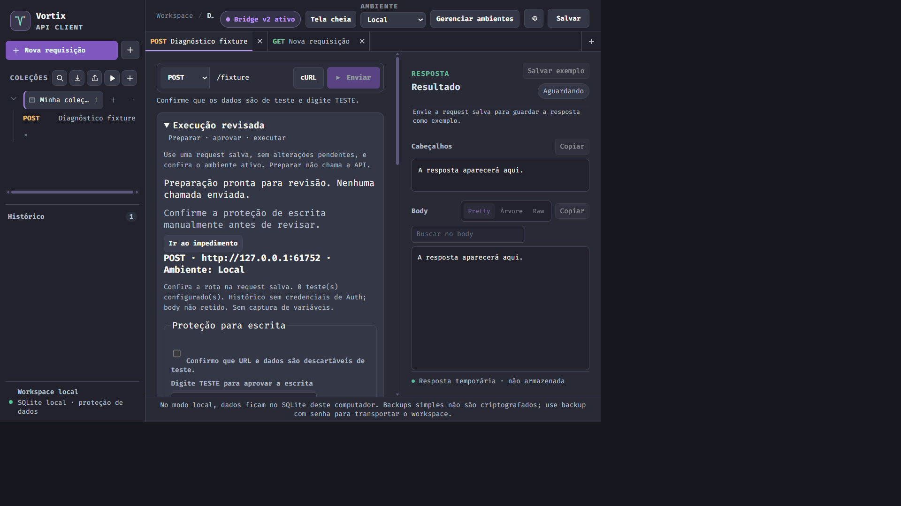
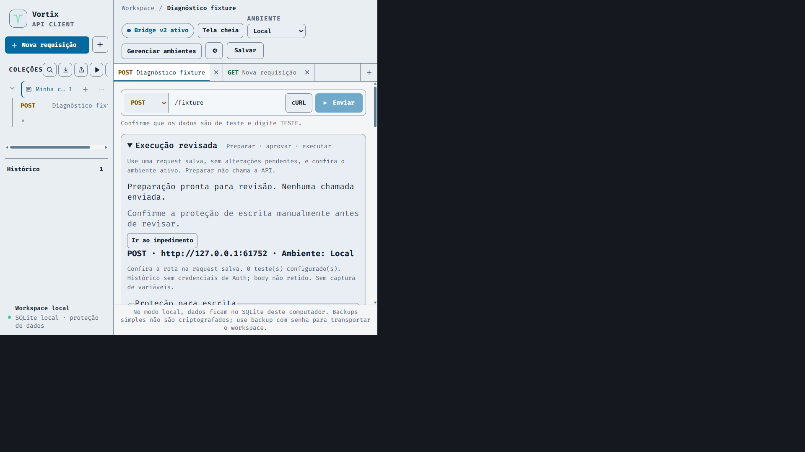
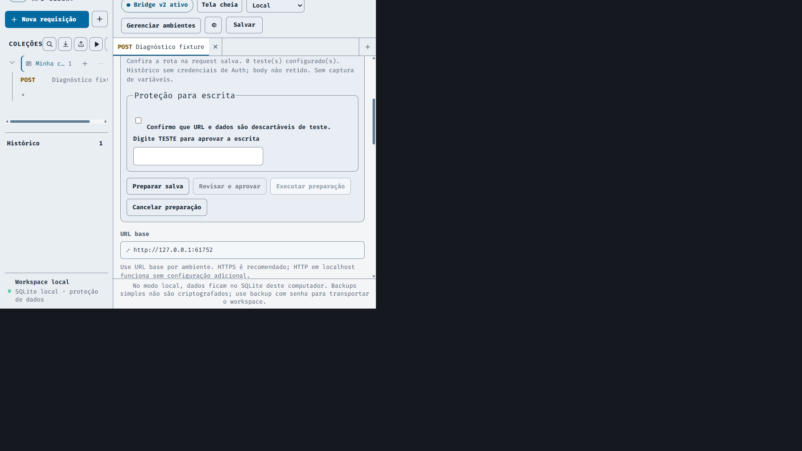

# Diagnóstico compacto — evidência de implementação

Data: 27/10/2026. Base: `master` em `eafccf9e80ac84e3682e1cbc0f9c666c66efba64`. Implementação autorizada e integrada no checkout principal; sem stage, branch, commit ou publicação. Conferência visual por imagem concluída na retomada solicitada pelo usuário, com o escopo abaixo.

## Coordenação e isolamento

Trabalho em checkout temporário detached, sem branch, stage ou commit. Agentes em terminais Maestri interativos e visíveis: Kakashi — Tech Lead, Sakura — Frontend e Shikamaru — QA. A CLI e as telas confirmaram atividade; Kakashi exibiu DeepSeek V4.1 Flash / OpenCode Go, Sakura e Shikamaru exibiram GPT-6 Luna xhigh. Não se trata de atestado independente do upstream.

Smoke usou instância local em porta livre, SQLite temporário e mock HTTP em loopback. Nenhum banco pessoal, credencial ou API real foi usado. Ao encerrar, os dois serviços foram parados pelo PID dos listeners verificados; terminais dos agentes e Portal **Vortix Diagnóstico QA** foram preservados. O Portal precisa de uma nova instância de QA para continuar a conferência visual. O worktree temporário foi mantido para rastreabilidade; contém uma cópia anterior aos últimos ajustes do checkout principal e não é a versão final.

## Verificações realizadas

- Projeção pura: 33/33 testes passaram; inclui limites UTF-8, relógio fracionário, contexto, frescor, catálogo e ausência de valores privados.
- Bridge e projeção: 48/48 passaram. A revisão independente reproduziu opções `Proxy` lançando exceção; correção em `readDiagnostic` limita o catch à seleção da vista e retorna `invalid_diagnostic_options`. O teste falhou antes e passou depois.
- Build Release: zero avisos e zero erros.
- Cinco suítes PowerShell passaram: hospedagem, proteção do workspace, Authorization Code PKCE, retenção e introspecção GraphQL. Isso preserva as verificações de servidor; não comprova a nova UI.
- Nove suítes Node no checkout principal após integração/correções: **403 testes, 402 aprovados, um ignorado** por `EPERM` de symlink no Windows, zero falhas. Sintaxe dos quatro scripts de produção, teste novo e benchmark conferida; `git diff --check` sem problemas.
- Build/sintaxe/diff e as cinco suítes PowerShell foram conferidos novamente no checkout principal após integrar a UI. Os ajustes posteriores afetaram somente publicação e testes JavaScript; a suíte Node completa foi repetida após eles.

## Revisão e correções

Shikamaru revisou o bridge e a UI somente leitura. Não identificou vazamento pelo registro nem chamada do diagnóstico aos callbacks de fontes/envio. Isso é revisão limitada do diff, não auditoria completa.

- Modal: o smoke mostrou `execution.review` por até um tick após abrir a confirmação. Atualização síncrona depois de abrir o diálogo remove a sugestão antes do `await`; o controller ainda exige aceitação, mesmo ID e controles válidos. Regressão falhou antes e passou depois; o teste persistido também consulta `window.vortixAgent.diagnose()` imediatamente, sem avançar timer.
- Aba ociosa: a revisão reproduziu origem anterior retida em `idle`. Agora o publicador adota a prontidão da aba ativa quando não há execução nem preparação válida; descarta impedimentos da origem anterior. Preparação válida e resultado continuam sujeitos à correspondência de contexto. Regressão cobre aba nova e falha de preparação antiga, sem envio.
- Texto de `unknown`: usa o catálogo do impedimento, distinguindo `diagnostic_stale` de indisponibilidade se esse formato chegar ao apresentador. O publicador corrente normalmente renova a observação; a degradação de frescor é verificada no leitor.

## Smoke funcional no Portal

- GET de fixture: preparação sem HTTP, revisão explícita, aprovação, execução única e HTTP 200. Resultado distinguiu `response_received`, persistência confirmada, captura não solicitada e `validation: not_run` com zero assertivas.
- Aba diferente omitiu o resultado anterior (`context_changed`); voltar à origem sem editar recuperou o resultado; editar a rota o invalidou.
- Variável ausente produziu `unresolved_variables`, código/target fixos e sugestão `environment.manage`. **Ir ao impedimento**, por clique e Enter, moveu foco a `manage-environments-direct` sem rede.
- POST preparado sem checkbox/`TESTE`: `write_confirmation_required`; revisão e execução desabilitadas, sem próxima ação de envio. Nenhum POST foi enviado.
- Mock registrou exatamente **um GET `/slow`**. Demais leituras, preparações, foco, navegação e bloqueio de escrita não acrescentaram chamadas.
- Viewports 1280×892 e 900×800; medição DOM em 900×800 manteve resumo, orientação e quatro controles dentro do card, com quebra de linha. Estilos computados conferidos em Dracula e Papel. Isso não substitui inspeção visual por imagem.
- Parcial, assertiva reprovada, timeout/entrega desconhecida e BFCache foram cobertos deterministicamente; não foram todos repetidos como fluxos visuais nesta rodada. Os cinco testes PowerShell preservam proteções local/público; não foi feito smoke visual do diagnóstico no modo público.

## Medição determinística

[`DiagnosticBenchmark.cjs`](../../../DiagnosticBenchmark.cjs) compara seis casos, três caminhos e cinco repetições, totalizando 90 observações. O [JSON correspondente](2026-10-27-compact-diagnostics-benchmark.json) registra dados por observação, agregados e hashes das entradas. Rode `node DiagnosticBenchmark.cjs` para regenerar o relatório a partir deste checkout.

O protocolo revisado cobra uma única vista de `diagnose()` suficiente para a tarefa. `blockers` e `result` já incluem o resumo; não há consulta extra a `summary`. Descoberta inicial **não foi medida**; todas as repetições representam leitura recorrente de fixtures conhecidas. Textos de UI são fixtures manuais e os parsers são determinísticos: sucesso não significa compreensão por IA.

| Caminho | Extração esperada | Bytes medianos | Leituras medianas |
| --- | --- | --- | --- |
| `execution.status` | 25/30 | 108 | 1 |
| Leitura focada atual | 30/30 | 305,5 | 7 |
| `diagnose`, uma vista | 30/30 | 307,5 | 1 |

O texto de status não distingue sozinho a confirmação de escrita no caso sintético correspondente. O diagnóstico não demonstrou redução de bytes ou latência frente à leitura focada; oferece campos e códigos estáveis com menos leituras nesse harness. Não há medição de tokens, custo total de ferramentas, descoberta comparável, rede, navegador ou agente. Cinco repetições não demonstram significância estatística.

Observação separada no Portal real: serializar `describe()` do contrato v2 resultou em 3.634 caracteres/bytes UTF-8, em uma consulta. Essa amostra mede somente o tamanho do retorno de descoberta existente; não mede raciocínio, busca de seletores ou custo de descoberta por caminho e não integra as 90 observações sintéticas.

## Conferência visual por imagem — retomada

As tentativas anteriores retornaram `screenshot timed out — the page is not rendering (its window may be minimized)`. Na retomada, a janela do Maestri foi confirmada sem minimização, em primeiro plano, com `document.readyState === 'complete'` e `visibilityState === 'visible'`; o erro persistiu. Ativar **Tela cheia** pelo controle existente do Vortix permitiu obter as primeiras capturas pelo Portal. A falha reapareceu após reload; a imagem final dos controles foi obtida por captura nativa da janela do Maestri, com a fixture ocupando a janela e estado do DOM conferido. Toda navegação permaneceu nos controles do Portal. Não foi comprovada a causa da falha de captura do Maestri.

Reutilizada somente a fixture/SQLite temporária, com servidor iniciado no checkout principal para carregar os últimos ajustes. Nenhuma request de teste foi enviada nesta retomada. Capturas inspecionadas em Dracula/Papel, com viewports CSS 1280×900 e 900×800 e escala da aplicação em 120%. Após o ajuste CSS, as nove suítes Node passaram novamente: 403 testes, 402 aprovados, um ignorado por symlink; diff sem problemas.

- Diagnóstico, indicação de impedimento e labels legíveis nos dois temas.
- Em 900×800, os controles quebram linha dentro do card; a rolagem mantém campo `TESTE` e botões acessíveis, sem sobreposição do diagnóstico.
- POST sem confirmação continua `write_confirmation_required`, sem sugestão de envio. **Ir ao impedimento** acionado com Enter moveu foco ao `summary` do painel.
- Capturas de fixture preservadas abaixo, sem dados pessoais. A imagem bruta do Portal pode incluir margem fora da área CSS testada.

Sakura revisou as três capturas em seu terminal visível, sem editar arquivos ou consultar APIs. Confirmou legibilidade e rolagem, mas observou que o botão primário parecia habilitado. O DOM confirmou `disabled: true`; acrescentada regra CSS restrita a `#structured-execute:disabled`, usando `--border`, `--muted` e `--surface` para remover a aparência de ação disponível. A imagem final abaixo já mostra o estado neutro no tema Papel; estilos computados também conferidos em Dracula. Guards e atributos de desabilitação não foram alterados.

Essa conferência cobre apresentação e navegação da fixture bloqueada. Permanecem os limites já registrados para modo público, BFCache real e demais cenários de execução; não foi feita auditoria completa de acessibilidade nem teste em 390 px.

## Próximo gate

A pendência de captura/revisão visual foi encerrada no escopo descrito acima. Ampliar medição para descoberta e tarefas reais somente em terminais visíveis, sem alegar economia de tokens antes de medir. Código, testes e documentação estão integrados localmente, preservando alterações anteriores. Commit, PR e publicação não estão incluídos nesta autorização.

## Revisão de entrega após reinício — 28/10/2026

- Checkout principal conferido em `master/eafccf9e80ac84e3682e1cbc0f9c666c66efba64`, sem stage. Inspeção executada no shell visível `Senku — Inspeção local` do Maestri, após falha do executor integrado. Nenhum outro agente foi iniciado.
- Antes das edições documentais desta revisão, SHA-256 dos 29 arquivos do manifesto pré-reinício: 29 iguais, zero divergentes/ausentes. ZIP não restaurado nem validado; TEMP não usado como fonte.
- Nove arquivos de suíte Node reexecutados no checkout final: **403 testes, 402 aprovados, um skip, zero falhas**, saída 0; duração registrada 6655,5368 ms.
- `node --check` passou nos quatro scripts de produção afetados e nos seis arquivos de testes/benchmark; `git diff --check` passou.
- Revisados diff de integração/CI/guias, módulo novo e mapa das regressões. Corrigida referência desatualizada do roadmap sobre validação em checkout isolado. Escopo de 27 arquivos e resumo sugerido registrados em [continuidade](../../continuity.md#escopo-proposto-para-versionamento).
- Esta retomada alterou apenas documentação. Build, suítes PowerShell, benchmark e revisão visual não foram repetidos; suas evidências anteriores e limites continuam acima. Nenhum request real, dependência, branch, stage, commit, PR ou publicação.
