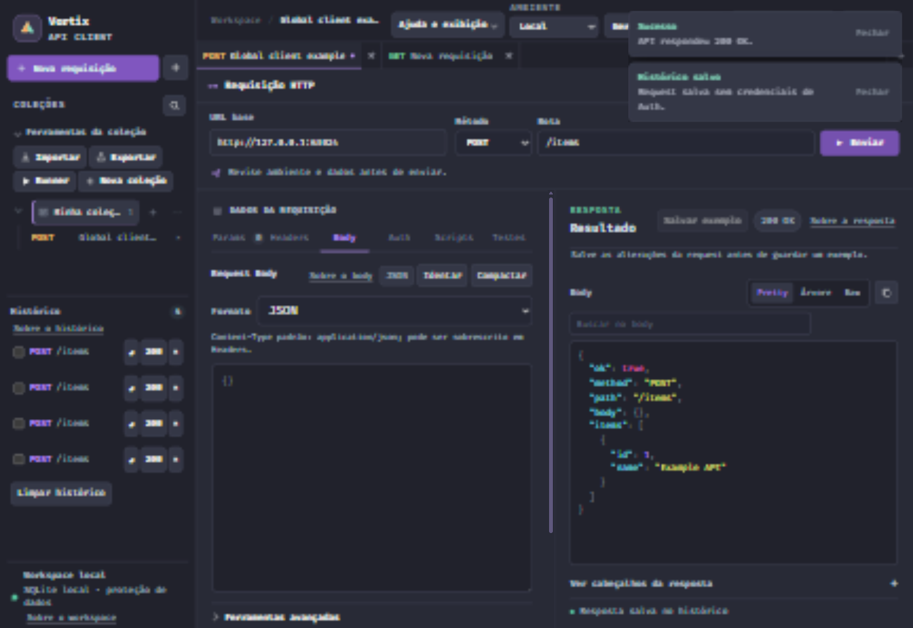
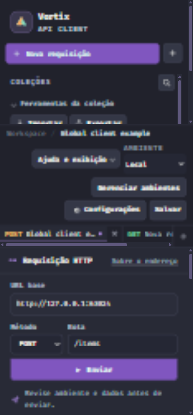

# Cliente de APIs de uso geral — 04/11/2026

## Comportamento entregue

- Editor manual: POST, PUT, PATCH e DELETE usam **Enviar**, sem frase `TESTE`, declaração de dados descartáveis ou diálogo extra por método.
- Execução revisada: mantém preparação, aprovação contextual, validade e uso único; remove a declaração e a frase de teste.
- Runner visual: mantém autorização explícita para escritas e confirmação dos destinos por execução, sem frase.
- Runner CLI: escritas continuam opt-in por `--allow-writes`. Removida a opção `--confirm-test-data`; scripts existentes devem retirar esse argumento.
- Proxy: remove apenas a exigência particular de dados de teste. Validações de body, destino, origem, SSRF e isolamento continuam ativas.
- UI: barra de endereço/envio acima do editor e resposta, painéis de mesma largura no desktop, ferramentas de coleção expostas, itens salvos em uma linha e controles que se ajustam a telas estreitas.
- Correção guiada anterior preservada. Ao restaurar rascunho com rota preenchida, a orientação de rota vazia agora é descartada.

## Evidência atual

- Build Release .NET: passou, zero erros e avisos.
- JavaScript: 467 testes, 466 aprovados, zero falhas, um pulado por falta de permissão de symlink no Windows. Inclui lógica, Runner CLI, bridge, diagnósticos, execução revisada, UI, dependências e correção guiada.
- `WorkspaceProtection.test.ps1`: passou. POST, PUT, PATCH e DELETE chegam à fixture sem os antigos campos; formatos de body e multipart continuam validados. Segredos cifrados, migração e reinício também passaram.
- `HostingMode.test.ps1`: passou, incluindo origem, isolamento de sessões, SSRF e rate limit.
- `GraphqlIntrospection.test.ps1`: passou.
- Portal Maestri **Vortix — Cliente global QA**: POST manual e execução revisada concluídos com HTTP 200 em fixture loopback. Salvar e alternar abas preservam o rascunho da barra de endereço.
- Viewports 1440×1000, 900×900 e 390×844: envio dentro da área disponível. No mobile, workspace e editor sem transbordamento horizontal. Temas Papel e Dracula inspecionados pelo portal.
- `git diff --check`: sem erros de whitespace. Há aviso do Git sobre conversão futura de LF para CRLF em uma spec anterior, já modificada antes desta tarefa.

## Limites e execução local

Validação usa banco temporário e fixture local, sem APIs reais nem banco pessoal. A navegação inicial em Chrome externo foi interrompida após a orientação do usuário; as verificações finais usaram o portal Maestri. Ao encerrar a validação inicial, ainda não havia commit, PR ou deploy. A publicação foi autorizada em etapa posterior, descrita abaixo.

O resultado aproxima o fluxo de edição e inspeção das referências; não adiciona equivalência completa de recursos com Postman ou Insomnia.

## Ajuste da sidebar Coleções

Após a captura do usuário, a área foi simplificada: título com busca, uma ação principal Nova coleção e gatilho Mais ações. Importar, Exportar e Executar seleção ficam num disclosure nativo fechado inicialmente, com conteúdo em fluxo para evitar recorte pela rolagem. A árvore fica logo abaixo do cabeçalho. Método HTTP mais estreito só na árvore; nomes completos preservados nos nomes acessíveis. Expandir/recolher anuncia alvo e estado; Escape fecha o disclosure e retorna foco ao gatilho.

Kakashi definiu a hierarquia; Hinata implementou apenas HTML/CSS/app.js; Sakura revisou o diff contra snapshots locais sem bloqueadores estáticos; Shikamaru atualizou os três testes pertinentes. Alterações anteriores do checkout foram preservadas.

- `node --test BeginnerUi.test.cjs AIFriendlyUi.test.cjs RunnerLogic.test.cjs`: 285/285 passaram, zero falhas, também confirmado pelo Maestro. As duas expectativas que ainda exigiam o botão duplicado foram atualizadas para o botão preservado.
- `node --check wwwroot/app.js` e `git diff --check`: passaram.
- Portal Maestri: ações realmente ocultas quando fechado (`checkVisibility`), três ações visíveis quando aberto, Escape/foco confirmados. Importar, Exportar, Runner e Nova coleção abrem os respectivos diálogos; todos fechados sem efetuar essas operações.
- Desktop 1440×1000: captura visual e interações conferidas. Viewport original 1840×1236 restaurado ao terminar.
- Mobile 390×844: cabeçalho e seção sem transbordamento horizontal; Executar seleção alcançável após rolagem, confirmado por hit test do DOM. Captura mobile indisponível: o comando retornou que a página não estava renderizando. Não foi forçada ativação da janela.
- Ativação nativa por Enter/Espaço não confirmada pela automação; Enter também não abriu um disclosure original do aplicativo. Isso limita a evidência de teclado, sem comprovar defeito específico desta alteração. Não houve auditoria completa de acessibilidade.

A captura desktop completa foi inspecionada durante a tarefa, mas o arquivo temporário não permaneceu disponível. Uma captura posterior veio recortada pelo canvas e foi descartada deste registro; não representa a sidebar inteira.

O ajuste da sidebar não alterou proxy, dependências ou autenticação. Na conclusão dessa fatia ainda não havia commit, PR ou deploy.

## Verificação para publicação — 04/11/2026

O usuário autorizou atualização de documentação, criação de PR e merge. O pacote reúne a correção guiada já integrada ao editor, a política de uso geral e o refinamento da sidebar. A CI passou a incluir `GuidedRequestCorrection.test.cjs`. Notas locais de retomada, `Orquestrador.md`, capturas anteriores sem relação com a entrega e `artifacts/` ficaram fora da seleção de publicação.

- `dotnet restore ./VortixApiClient.csproj`: passou.
- `dotnet build ./VortixApiClient.csproj -c Release --no-restore --nologo`: passou, zero erros e avisos.
- Suíte JavaScript completa, incluindo a correção guiada: 468 testes; 467 aprovados, zero falhas e um skip por permissão de symlink no Windows.
- `HostingMode.test.ps1`, `WorkspaceProtection.test.ps1`, `AuthorizationCodePkce.test.ps1`, `HistoryRetention.test.ps1` e `GraphqlIntrospection.test.ps1`: todos passaram.
- Validação com dados fictícios, mocks loopback e bancos temporários. O backup da árvore de trabalho ficou fora do diretório do projeto, e o processo de QA foi identificado e interrompido durante o build para liberar a DLL; nenhum processo pessoal foi encerrado.

Esses resultados são locais. O estado dos checks remotos e do merge deve ser consultado no PR, sem inferir aprovação remota deste registro.
